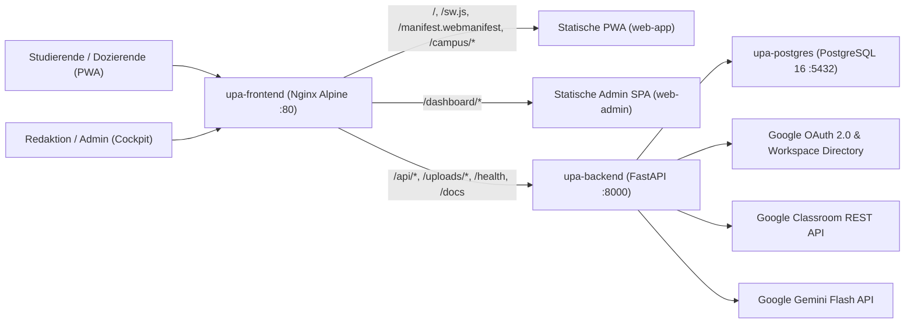

# Pflichtenheft: UPA App (Campus PWA und Web Admin Cockpit)

**Projekt:** Zentrale Hochschulplattform der Universidad Paraguayo Alemana (UPA)  
**Dokumentstatus:** Verbindliches Pflichtenheft (Produktivstand)  
**Zielsysteme:** Studenten Progressive Web App (`web-app/`), Administratives Redaktionsportal (`web-admin/`), FastAPI Backend (`backend/`), PostgreSQL 16 (`upa-postgres`)

## 1. Ausgangslage und Zielsetzung

Die Universidad Paraguayo Alemana (UPA) benoetigt eine zentrale, verlaessliche und wartungsarme digitale Kommunikations- und Terminplattform fuer den gesamten Campusbetrieb. Bisherige Informationswege ueber verteilte Kanaele wie E-Mail Verteiler, soziale Netzwerke (`@upalemana` auf Instagram), Aushaenge und separate Kursplattformen fuehrten zu Medienbruechen, verpassten Anmeldefristen und hohem manuellem Pflegeaufwand in der Hochschulverwaltung.

Ziel der **UPA App** ist die Bereitstellung einer einheitlichen Plattform nach dem Prinzip der **Single Source of Truth**:

1. **Zentrale Hochschul PWA (`web-app/`):** Eine auf Mobilgeraete optimierte Progressive Web App (Mobile First fuer Android und iOS, Trusted Web Activity Ready), ueber die Studierende und Dozierende jederzeit auf offizielle Eilmeldungen, Campus Neuigkeiten, Veranstaltungen mit 1 Klick Anmeldung sowie ihre persoenlichen Google Classroom Abgabefristen zugreifen koennen.
2. **Administrations- und Redaktionsportal (`web-admin/`):** Ein rollenbasiertes Desktop Cockpit unter `/dashboard/`, in dem Redaktion und Systemadministration saemtliche Publikationen, Veranstaltungen, Zielgruppen, Modulberechtigungen, KI Parameter und Systemdiagnosen an einem zentralen Ort steuern.
3. **Multimodale KI Unterstuetzung:** Automatisierte Erkennung von Veranstaltungsdaten aus offiziellen Instagram Beitraegen sowie intelligentes Ausfuellen leerer Formularfelder im Redaktionseditor mittels Google Gemini Flash.

## 2. Zielgruppen und Rollenkonzept

Der Zugang zur Plattform erfolgt ausschliesslich ueber verifizierte institutionelle Konten der Domain `@upa.edu.py` (Google OAuth 2.0). Das System unterscheidet vier funktionale Nutzergruppen sowie eine granulare **Least Privilege Berechtigungsmatrix mit 6 kanonischen Modulrechten** im Administrationsportal.

### 2.1 Zielgruppen im Hochschulbetrieb

* **Nicht angemeldete Besucher (Oeffentlicher Modus):** Sehen im Campus Feed ausschliesslich oeffentliche Instagram Beitraege (`@upalemana`), die fuer `ALL` freigegeben sind. Interne Hochschulmitteilungen, Eilmeldungen, Event Anmeldungen und Classroom Fristen erfordern eine Anmeldung.
* **Studierende (`role = "user"`):** Nutzen die mobile PWA zum Lesen zielgruppengenauer News (z.B. nach Studiengang `TIE`, `PI`, `TI` oder Semester), zur Teilnahme an Campus Veranstaltungen per 1 Klick RSVP und zur Verfolgung ihrer persoenlichen Google Classroom Abgabefristen.
* **Dozierende (`role = "user"` mit Gruppe `docentes` / `PROF`):** Erhalten fakultaets- und lehrkoerperspezifische Mitteilungen, akademische Termine und Campus Veranstaltungen in der PWA.
* **Redaktion und Marketing (`role = "editor"`):** Pflegen im Web Admin Cockpit (`/dashboard/publicaciones`) Mitteilungen, Veranstaltungen, Medienanhaenge, KI Vorschlaege und Teilnehmerlisten.
* **Systemadministration (`role = "admin"`):** Besitzt die Berechtigung `roles` und verwaltet zusaetzlich Zielgruppen, Berechtigungsrollen, die Google Gemini KI Konfiguration, Systemdiagnosen und das Audit Protokoll.

### 2.2 Kanonische 6 Rechte Matrix (Least Privilege)

Die Zugriffskontrolle im Backend (`backend/src/permissions.py`) und im Web Admin Cockpit (`web-admin/app.js`) basiert auf exakt 6 kanonischen Berechtigungsschluesseln (`PERMISSION_KEYS`). Neue Konten in der Rollenverwaltung starten standardmaessig ohne gesetzte Haekchen (`[]`), und das System stellt technisch sicher, dass niemals das letzte Konto mit der Berechtigung `roles` entfernt oder herabgestuft werden kann:

| Berechtigungsschluessel | Cockpit Modul | Technische Berechtigung und geschuetzte Endpunkte |
|---|---|---|
| `publicaciones` | Publicaciones (`/dashboard/publicaciones`) | Erstellen, Bearbeiten und Loeschen von Mitteilungen und Events (`/api/publications`), Medienupload (`/api/media/upload`), KI Autocomplete (`/api/publications/autocomplete-ai`), Instagram Sync (`/api/publications/sync-instagram`) und Einsicht in Teilnehmerlisten (`/api/publications/{id}/registrations`). |
| `grupos` | Grupos (`/dashboard/grupos`) | Verwaltung institutioneller Zielgruppen (`/api/groups`), Einsicht in zugeordnete E-Mail Listen und Abruf der Google Workspace Domain Gruppen (`/api/groups/google-workspace`). |
| `roles` | Roles (`/dashboard/roles`) | Autorisierung institutioneller Konten und Vergabe der 6 Modulberechtigungen (`/api/roles`). Verleiht automatisch den abgeleiteten Status `admin`. |
| `ia` | Control de IA (`/dashboard/ia`) | Konfiguration des Google Gemini API Schluessels, Anpassung der KI System Prompts und Durchfuehrung des Live Verbindungstests (`/api/ai/config`, `/api/ai/test-connection`). |
| `apis` | APIs (`/dashboard/apis`) | Zugriff auf Echtzeit Systemdiagnose, Datenbank Pool Metriken und Status externer Integrationen (`/api/system/diagnostics`). |
| `historial` | Historial (Audit Log) | Lesezugriff auf das revisionssichere Aenderungsprotokoll fuer Publikationen, Gruppen und Rollen inklusive Feld Diffs (`/api/history/{entity_type}`). |

## 3. Funktionale Spezifikation der Studenten PWA (`web-app/`)

### 3.1 Desktop QR Code Landingpage und Mobile Weiche

Beim Aufruf der Wurzel URL (`/`) prueft `isMobileEnvironment` in `web-app/campus-core.js` die Client Umgebung:

* **Desktop Ansicht (`#landing`):** Auf Desktop Browsern wird automatisch eine zweispaltige Landingpage dargestellt. Links erscheint ein interaktives Smartphone Vorschaumodell (`phone-mockup`) mit der echten Oberflaeche der App, rechts ein lokal erzeugter SVG QR Code (`buildQr`), der dynamisch auf die aktuelle Serveradresse verweist. Ueber `Probar la versión web aquí` (`/?app=1`) laesst sich die mobile Ansicht direkt im Desktop Browser testen (mit permanenter Rueckkehrleiste `Volver al código QR`). Im Footer fuehrt der dezente Link `Acceso Administrativo` direkt zum Web Admin Cockpit (`/dashboard/`).
* **Mobile PWA Ansicht (`#app`):** Auf Android und iOS Smartphones sowie im installierten Standalone Modus (`display: "standalone"`) startet unmittelbar die App Shell mit den drei Hauptreitern `Inicio`, `Agenda` und `Perfil`.

### 3.2 Reiter Inicio (Campus Feed, Eilmeldungen und Instagram)

Der Reiter `Inicio` konsumiert `GET /api/v1/feed` (sowie abwaertskompatibel `/api/feed`) und gliedert sich in:

* **Dringende Eilmeldungen (`urgent_banners` vom Typ `EMERGENCY_BANNER`):** Werden prominent oberhalb des Feeds als Warnbanner dargestellt und nach Ablauf von `expires_at` automatisch ausgeblendet.
* **Kombinierter Campus Stream (`posts`):** Zeigt angepinnte Beitraege (`is_pinned = true`) zuerst, gefolgt von chronologisch sortierten Campus Mitteilungen, Veranstaltungen und synchronisierten Instagram Beitraegen (`@upalemana`). Instagram Posts tragen das offizielle Kamera Badge; von der KI als Event erkannte Posts enthalten strukturierte Terminangaben.
* **Vollbild Detailansicht (`#detail`):** Ein Tippen auf eine Karte oeffnet ein Vollbild Overlay mit hochaufloesendem Bild, nativem HTML5 Videoplayer (`MP4`, `WEBM`) oder Dokumentenlink (`PDF`), vollstaendigem Text mit klickbaren Links, Terminblock und dedupliziertem Quellenbutton (`Ver en Instagram` bzw. `Abrir enlace`). Der Overlay Manager (`createOverlayManager`) unterstuetzt die native Zurueck Geste auf Android.

### 3.3 1 Klick RSVP Event Anmeldung mit Zwei Button Muster

Fuer Veranstaltungen mit aktivierter Teilnahmeregistrierung (`is_event = true` und `has_registration = true`) stellt die PWA sowohl auf der Feed Karte als auch in der Vollbild Detailansicht und in der Agenda ein synchrones **Zwei Button Muster** bereit:

* **Zusage Button (`Sí, asistiré`):** Sendet `POST /api/events/{event_id}/register` (bzw. `POST /api/publications/{id}/rsvp` mit `status = "attending"`), speichert die Zusage idempotent in der Tabelle `event_registrations` und markiert den Button aktiv (`aria-pressed="true"`). Ein erneuter Klick auf den bereits aktiven Button zieht die Rueckmeldung zurueck.
* **Absage Button (`No asistiré`):** Sendet `DELETE /api/events/{event_id}/register` (bzw. `status = "declined"`), speichert die Absage idempotent in `event_registrations` und hebt den Absage Button visuell hervor.
* **Synchroner UI Zustand:** Jede Statusaenderung aktualisiert sofort und ohne Seitenneuladen die Darstellung im Feed, im Detail Overlay, in der Agenda Liste und im lokalen Nutzercache (`applyRegistrationUpdate`).

### 3.4 Reiter Agenda (Kalender und Google Classroom Abgabefristen)

Der Reiter `Agenda` ruft `GET /api/v1/agenda` ab und kombiniert Hochschulveranstaltungen (`events`) mit den persoenlichen Aufgaben aus Google Classroom (`deadlines`):

* **Zweigeteilte Darstellung:** Im oberen Bereich befindet sich die chronologische Terminliste (gruppiert nach Monaten oder gefiltert auf einen ausgewaehlten Kalendertag), im unteren Bereich ein kompakter Monatskalender (`monthGrid`) mit farbigen Markierungspunkten fuer Veranstaltungen und Abgabefristen.
* **Zeitzone `America/Asuncion`:** Alle UTC Zeitstempel der Datenbank sowie die von der Google Classroom API gelieferten Abgabezeiten (`dueDate` / `dueTime`) werden verbindlich in der paraguayischen Lokalzeit `America/Asuncion` formatiert und dem exakten Kalendertag zugeordnet.
* **Direkter Classroom Absprung:** Jede Classroom Aufgabe zeigt den Kursnamen, die exakte Uhrzeit (`Vence HH:MM hs`) und oeffnet per Klick den direkten `alternate_link` in Google Classroom.

### 3.5 Reiter Perfil (3 Wege Theme, Benachrichtigungen und Sitzung)

* **Verifizierte Hochschulidentitaet:** Zeigt Initialen Avatar, vollstaendigen Namen, E-Mail Adresse (`@upa.edu.py`) und die abgeleitete Rollenbezeichnung (`Estudiante`, `Docente`, `Redacción`, `Administración`).
* **3 Wege Theme System:** Umschalter zwischen `Sistema` (`system`), `Modo Claro` (`light`) und `Modo Oscuro` (`dark`). Passt das Attribut `data-theme` sowie `<meta name="theme-color">` (`#ffffff` bzw. `#0f172a`) verzögerungsfrei an.
* **Benachrichtigungssteuerung:** Individuelle Schalter fuer `Eventos`, `Avisos y comunicados` und `Fechas límite` (persistent in `localStorage` unter `upa_campus_notifications`).
* **Sicheres Abmelden:** Entfernt das JWT Sitzungstoken (`upa_campus_token`) und loescht saemtliche nutzerbezogenen Cache Eintraege (`upa_campus_cache_*`).

## 4. Funktionale Spezifikation des Web Admin Cockpits (`web-admin/`)

### 4.1 Single Source of Truth Editor fuer Publikationen (`/dashboard/publicaciones`)

Alle redaktionellen Inhalte werden zentral in der Tabelle `posts` ueber `/api/publications` verwaltet:

* **Hybrides Datenmodell:** Ein Beitrag kann gleichzeitig als Campus Mitteilung (`is_news = true`), als Kalenderveranstaltung (`is_event = true`) oder als Kombination aus beidem veroeffentlicht werden.
* **Validierungsregeln:** Pflichtfeld Titel (`title`), Pflichtablaufdatum (`expires_at`) bei angepinnten Beitraegen (`is_pinned = true`) und strikte Eintagesregel fuer Veranstaltungen (Start und Ende muessen am selben Kalendertag in `America/Asuncion` liegen, wobei `event_end > event_start` gilt).
* **Medienupload (`/api/media/upload`):** Unterstuetzt Bilder (`JPG`, `PNG`, `WEBP`), Videos (`MP4`, `WEBM`) und Dokumente (`PDF`) bis maximal `10 MB` (`10485760` Bytes) inklusive serverseitiger Magic Byte Pruefung.
* **Instagram Schreibschutz:** Bei aus Instagram synchronisierten Beiträgen (`post_type = "INSTAGRAM"`) sind Originaltext, Medien URL, Permalink und Veroeffentlichungsdatum im Editor schreibgeschuetzt, waehrend Titel, Zielgruppen, Anpinnen und Event Parameter redaktionell gepflegt werden koennen.
* **Reichweiten- und RSVP Statistik:** Die Publikationstabelle und die Detailansicht zeigen die Anzahl eindeutiger studentischer Aufrufe (`views_count` aus `post_views`) sowie die vollstaendige Teilnehmerliste (`attending_count`, `declined_count` und Einzelpersonen ueber `GET /api/publications/{id}/registrations`).

### 4.2 Deep Linking und URL Routing (`UpaRouter`)

Das Web Admin Cockpit implementiert ein vollwertiges History API Routing (`web-admin/app.js`, `web-admin/editorial.js`), sodass jede Ansicht per direktem Link oder Browser Reload (`F5`) aufgerufen werden kann:

* `/dashboard/publicaciones`: Tabellarische Uebersicht aller Publikationen mit Such- und Typfilter.
* `/dashboard/publicaciones/nueva`: Oeffnet direkt das leere Formular zum Anlegen einer neuen Publikation.
* `/dashboard/publicaciones/:id` (z.B. `/dashboard/publicaciones/60`): Oeffnet direkt den Editor fuer die Publikation mit der numerischen ID `:id`. Existiert die ID nicht (`HTTP 404`) oder ist das Segment ungueltig, zeigt das Cockpit eine klare Rückmeldung und fuehrt sauber auf `/dashboard/publicaciones` zurueck.
* `/dashboard/grupos`, `/dashboard/roles`, `/dashboard/ia`, `/dashboard/apis`: Kanonische Modulrouten entsprechend den Berechtigungen des angemeldeten Kontos.

### 4.3 Multimodales KI Autocomplete und KI Steuerung (`Google Gemini Flash`)

* **Smart Editor Autocomplete (`POST /api/publications/autocomplete-ai`):** Der Button `Autocompletar con IA` im Publikationseditor uebertraegt die bereits eingetragenen Formularwerte zusammen mit dem hochgeladenen Plakatbild oder PDF (`JPG`, `PNG`, `WEBP`, `PDF`) an Google Gemini Flash (`gemini-2.0-flash`). Der Dienst gibt **ausschliesslich Vorschlaege fuer noch leere Formularfelder** zurueck; bereits vom Redakteur ausgefuellte Felder bleiben garantiert unangetastet. Ohne Bild oder Textkontext verhindert das Grounding System (`_enforce_autocomplete_grounding`), dass freie Termine oder Orte halluziniert werden.
* **Automatische Instagram Event Extraktion (`backend/src/services/ai_extractor.py`):** Beim Synchronisieren neuer Instagram Posts analysiert die KI Caption und Bild multimodal. Wird eine reale Veranstaltung mit Startzeit erkannt, wird der Beitrag automatisch mit `is_event = true` und `is_ai_generated = true` (Badge `IA`) veroeffentlicht.
* **Cockpit Modul Control de IA (`/dashboard/ia`):** Erlaubt das maskierte Hinterlegen des Google AI Studio API Schluessels in PostgreSQL (`app_settings`), das Anpassen der System Prompts fuer Autocomplete und Instagram Extraktion sowie einen Echtzeit Verbindungstest (`POST /api/ai/test-connection`).

### 4.4 Zielgruppenverwaltung und Audit Protokollierung

* **Zielgruppen (`GET/POST/PUT/DELETE /api/groups`):** Verwaltet kuratierte Zielgruppen (`ALL`, `estudiantes`, `docentes`, `staff`, `egresados`, `TIE`, `PI`, `TI`, `PROF`) und verknuepft diese mit realen Google Workspace Verteilern (`google_groups`) sowie individuellen E-Mail Listen (`emails`).
* **Revisionssicheres Audit Log (`GET /api/history/{entity_type}`):** Jede Erstellung, Aenderung oder Loeschung an Publikationen (`post`), Zielgruppen (`group`) und Berechtigungsrollen (`role`) wird in `admin_audit_logs` mit Zeitstempel, ausfuehrendem Konto und exaktem Feld Diff (`changed_fields`, `permissions_diff`) protokolliert.

## 5. Schnittstellen und Systemarchitektur

### 5.1 Externe und interne Systemschnittstellen

1. **Google OAuth 2.0 (`@upa.edu.py`):** Serverseitiger Authorization Code Flow (`GET /api/auth/login-google` und Callback `GET /api/auth/google`) sowie direkter ID Token Login (`POST /api/auth/google`). Erzwingt `hd=upa.edu.py`, lehnt externe Domains strikt mit `HTTP 403` ab und stellt signierte JWT Bearer Tokens (`HS256`) aus.
2. **Google Classroom API:** Synchronisiert Kurse (`GET /api/classroom/courses`) und Abgabefristen (`GET /api/classroom/deadlines`). Beinhaltet einen automatischen OAuth Token Refresh ueber `classroom_refresh_token` sowie einen persistenten Datenbank Fallback (`users.classroom_deadlines_cache`, Header `X-Classroom-Cache: db_fallback`) bei Netzwerk- oder Upstream Timeouts.
3. **Google Workspace Admin Directory API:** Synchronisiert ueber einen Service Account mit Domain Wide Delegation (`GOOGLE_SERVICE_ACCOUNT_FILE`, `GOOGLE_ADMIN_DELEGATED_USER`) die Gruppenmitgliedschaften der Studierenden und die Domain Gruppenliste.
4. **Google Gemini Flash API:** Multimodale REST Anbindung (`https://generativelanguage.googleapis.com`, Standardmodell `gemini-2.0-flash`, Timeout `15.0s`, Bildlimit `4 MB`) mit strikter JSON Schema Validierung.
5. **PostgreSQL 16 Relationale Datenhaltung:** Verwaltet ueber SQLAlchemy 2.0 und Alembic Migrationen die Tabellen `users`, `posts`, `event_registrations`, `post_views`, `audience_groups`, `user_roles`, `device_tokens`, `admin_audit_logs` und `app_settings`.
6. **Nginx Reverse Proxy:** Terminiert Client Anfragen im Container `upa-frontend`, liefert statische PWA- und Cockpit-Assets aus, loest SPA Deep Links (`/dashboard/*`) auf `index.html` auf und leitet `/api/`, `/uploads/`, `/health`, `/docs` und `/openapi.json` an `http://backend:8000` weiter.

## 6. Nicht-funktionale Anforderungen und Sicherheit

1. **Zero Mock Doktrin (`scripts/audit_zero_mock.py`):** Im gesamten Produktivcode (`backend/`, `web-app/`, `web-admin/`) sind Mock Bibliotheken, Dummy Flags (`MOCK_MODE`, `SKIP_AUTH`), leere Stubs und Scheintests ohne Assertions verboten. Alle externen HTTP Aufrufe (`httpx`) muessen explizite Timeouts definieren.
2. **Datenschutz bei Teilnehmerzahlen und Gruppenlisten:**
   * Die detaillierte Teilnehmerliste einer Veranstaltung (`full_name`, `email`, `status`, `registered_at`) ist ausschliesslich fuer berechtigte Redakteure und Administratoren ueber `GET /api/publications/{id}/registrations` einsehbar.
   * In den Endpunkten fuer Studierende (`GET /api/v1/feed`, `GET /api/v1/agenda`, `POST /api/events/{id}/register`, `DELETE /api/events/{id}/register`) wird der Teilnehmerzaehler `registered_count` aus Datenschutzgruenden stets mit `0` ausgeliefert; jeder Studierende sieht nur seinen eigenen Status (`is_registered` und `registration_status`).
   * In `GET /api/auth/me` werden fuer regulaere Studierende (`role != "admin"`) die Felder `groups` und `google_groups` als leere Listen `[]` ausgegeben, und `GET /api/groups` liefert ohne die Berechtigung `grupos` keine E-Mail Adressen aus.
3. **Netzwerk- und Port Beschraenkung auf `127.0.0.1`:** Die PostgreSQL Datenbank Container binden ihren Host Port ausschliesslich an das lokale Loopback Interface (`127.0.0.1:5432:5432` in `docker-compose.yml` und `127.0.0.1:5433:5432` in `docker-compose.beta.yml`) und sind niemals direkt aus externen Netzwerken erreichbar.
4. **Service Worker Versionierung (`1.0.3`) und Offline Shell:** Der Service Worker (`web-app/sw.js`) versioniert den statischen App Shell Cache deterministisch unter `upa-campus-shell-1.0.3` (`VERSION = "1.0.3"`) und invalidiert veraltete Query Varianten automatisch. Private Pfade (`/api/*`, `/dashboard*`) werden im Service Worker niemals zwischengespeichert.
5. **Geheimnisschutz:** API Schluessel, OAuth Secrets und Service Account Dateien werden niemals in Git gespeichert, sondern ueber `.env` oder verschluesselt/maskiert in `app_settings` gehalten.

## 7. Betriebsumgebungen

Die Plattform wird in zwei vollstaendig voneinander isolierten Docker Compose Umgebungen betrieben:

| Merkmal | Produktionsumgebung (`docker-compose.yml`) | Beta Umgebung (`docker-compose.beta.yml`) |
|---|---|---|
| **Oeffentliche HTTPS URL (NetBird)** | `https://upa.eu1.netbird.services` | `https://upa-beta.eu1.netbird.services` |
| **Frontend Container & Host Port** | `upa-frontend` auf Port `8085` (`8085:80`) | `upa-frontend-beta` auf Port `8185` (`8185:80`) |
| **Backend Container & Host Port** | `upa-backend` auf Port `8000` (`8000:8000`) | `upa-backend-beta` auf Port `8100` (`8100:8000`) |
| **PostgreSQL Container & Binding** | `upa-postgres` auf `127.0.0.1:5432:5432` | `upa-postgres-beta` auf `127.0.0.1:5433:5432` |
| **Docker Volumes** | `postgres_data`, `uploads_data` | `postgres_beta_data`, `uploads_beta_data` |
| **`APP_ENV` & Visuelle Kennzeichnung** | `production` | `beta` (zeigt dezentes `BETA` Badge in PWA und Cockpit) |
