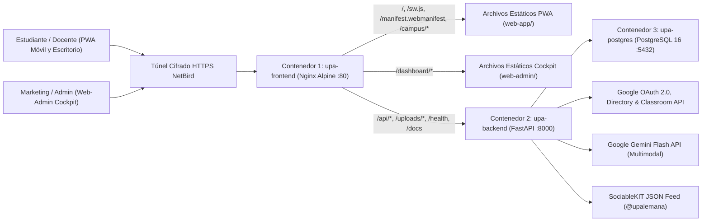
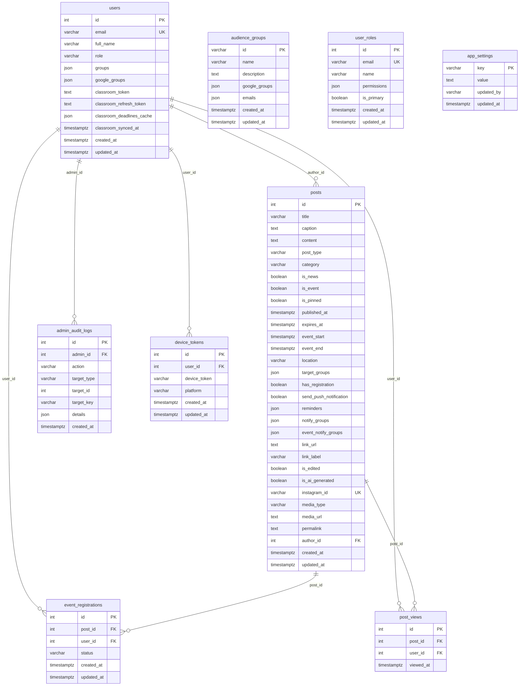

# UNIVERSIDAD PARAGUAYO ALEMANA (UPA)

**Carrera:** Informática Empresarial (Business Informatics)  
**Documento:** Trabajo Práctico de Arquitectura y Plataforma Digital Universitaria (UPA App)

| Metadato | Detalle Institucional |
|---|---|
| **Institución** | Universidad Paraguayo Alemana (UPA), San Lorenzo, Paraguay |
| **Proyecto** | UPA App: Plataforma Digital y Campus Móvil Centralizado |
| **Repositorio Oficial** | `https://github.com/Pascal-Thommen/upa-app` |
| **Autores** | Pascal Thommen, Natasha Colman y Equipo de Desarrollo UPA |
| **Versión** | v4.0 (03 de noviembre de 2026) Producción y Beta |

## Capítulo 1: Introducción, Resumen Ejecutivo y Guía Visual de la Plataforma (Executive Summary and Visual Overview)

### 1.1 Propósito y Enfoque desde la Informática Empresarial (Business Informatics)

El presente documento técnico y estratégico describe la concepción arquitectónica, la fundamentación de las decisiones de ingeniería, el modelo de datos relacional y la especificación funcional completa de la plataforma **UPA App** para la Universidad Paraguayo Alemana (UPA). Concebido desde la disciplina de la Informática Empresarial (Business Informatics), este informe articula la alineación entre las necesidades reales de comunicación del campus y una arquitectura de software moderna, mantenible y verificable en producción.

En lugar de presentar supuestos teóricos o funcionalidades simuladas, toda la documentación aquí expuesta refleja de manera exacta y fidedigna el código productivo alojado en el repositorio oficial (`web-app/`, `web-admin/` y `backend/`). El objetivo de este documento es permitir que el cuerpo docente y directivo comprenda en su totalidad tanto el porqué de cada decisión tecnológica como el funcionamiento concreto de cada pantalla de la aplicación estudiantil y del portal administrativo sin necesidad de conocimientos previos del código fuente.

### 1.2 Síntesis de la Infraestructura Productiva Implementada

La plataforma UPA App se encuentra desplegada y operativa sobre una arquitectura desacoplada de tres contenedores Docker (`upa-frontend`, `upa-backend` y `upa-postgres`), consolidando los siguientes pilares técnicos:

1. **Aplicación Web Progresiva Estudiantil (Progressive Web App, PWA):** Cliente móvil responsivo (`web-app/`) accesible desde cualquier navegador en Android e iOS sin fricción de tiendas de aplicaciones, equipado con Trabajador de Servicio (Service Worker, `/sw.js` versión `1.0.3`), Manifiesto de Aplicación Web (Web App Manifest, `/manifest.webmanifest`), caché local inteligente y página de aterrizaje de escritorio con código de respuesta rápida (Quick Response Code, QR) dinámico.
2. **Panel de Administración Web (Web-Admin Cockpit):** Portal editorial de escritorio (`/dashboard/`) servido por Nginx con enrutamiento profundo (Deep Linking) para la gestión unificada de noticias, eventos, grupos de audiencia, roles de permisos, configuración de Inteligencia Artificial (Artificial Intelligence, IA), diagnóstico de servicios e historial de auditoría.
3. **Servicio Backend REST en Python (FastAPI):** Interfaz de Programación de Aplicaciones (Application Programming Interface, API) bajo el estilo de Transferencia de Estado Representacional (Representational State Transfer, REST) con validación estricta en Pydantic v2, tipado estático verificado con Pyright y especificación interactiva OpenAPI 3.1 disponible en `/docs`.
4. **Base de Datos Relacional PostgreSQL 16:** Motor relacional central gestionado mediante el Mapeo Objeto-Relacional (Object-Relational Mapping, ORM) SQLAlchemy 2.0 y migraciones versionadas con Alembic, compuesto por 9 tablas productivas depuradas y vinculadas exclusivamente a la lógica real del sistema.
5. **Integraciones Institucionales e Inteligencia Artificial Multimodal:** Autenticación mediante Inicio de Sesión Único (Single Sign-On, SSO) con Google OAuth 2.0 restringido al dominio `@upa.edu.py`, sincronización de grupos de Google Workspace, integración de fechas de entrega con Google Classroom API, ingesta del feed de Instagram (`@upalemana`) a través de SociableKIT y procesamiento multimodal de afiches mediante **Google Gemini Flash**.

### 1.3 Introducción Visual al Ecosistema UPA App

Para facilitar la comprensión inmediata del sistema antes de profundizar en las decisiones de ingeniería, la plataforma se divide en dos grandes superficies de interacción conectadas al mismo núcleo relacional:

* **Superficie 1 (Comunidad Estudiantil y Docente):** Al abrir `https://upa.eu1.netbird.services` desde una computadora, el usuario visualiza una página de bienvenida con una vista previa interactiva de teléfono y un código QR dinámico para abrir la aplicación en su teléfono móvil. Al ingresar desde un teléfono (Android o iPhone), se carga directamente la Aplicación Web Progresiva (PWA) con tres pestañas inferiores: **Inicio** (avisos urgentes, noticias, Instagram e inscripción rápida a eventos), **Agenda** (calendario mensual y entregas de Google Classroom) y **Perfil** (identidad `@upa.edu.py`, tema visual y preferencias).
* **Superficie 2 (Equipo de Marketing, Redacción y Administración):** Al acceder a `https://upa.eu1.netbird.services/dashboard/`, el personal autorizado dispone de un panel de control de escritorio organizado en módulos según sus permisos: **Publicaciones** (con el botón `Autocompletar con IA`), **Grupos**, **Roles**, **Control de IA**, **APIs** e **Historial**.

> **[ESPACIO PARA CAPTURA DE PANTALLA #1: Panorama General de Entrada (Landing Page de Escritorio y Vista Móvil)]**  
> **Ruta a capturar:** `https://upa.eu1.netbird.services/` en un navegador de escritorio (pantalla completa).  
> **Qué mostrar en la imagen:** La vista de dos columnas de la página de aterrizaje donde se observa a la izquierda el marco interactivo del teléfono móvil (`phone-mockup`) ejecutando la PWA real en vivo, y a la derecha el bloque con el código QR vectorial (`#qr-box`) y las instrucciones de acceso.  
> **Elementos a marcar o resaltar en la diapositiva o imagen:**  
> 1. **Recuadro 1 (Izquierda):** Marcar el teléfono interactivo mostrando las pestañas `Inicio`, `Agenda` y `Perfil`.  
> 2. **Recuadro 2 (Derecha arriba):** Marcar el código QR dinámico que permite abrir e instalar la PWA en segundos desde Android o iOS sin pasar por tiendas de aplicaciones.  
> 3. **Recuadro 3 (Derecha abajo / Pie de página):** Marcar el enlace `Probar la versión web aquí` (`/?app=1`) y el botón discreto `Acceso Administrativo` (`/dashboard/`).

## Capítulo 2: Planteamiento del Problema y Solución Propuesta (Problem Statement and Solution Design)

### 2.1 Planteamiento del Problema: Fragmentación Comunicacional en la UPA

En la operativa diaria de la Universidad Paraguayo Alemana (UPA), la comunicación institucional entre la administración, el cuerpo docente y una comunidad estudiantil de **menos de 1.000 estudiantes** se encuentra fragmentada a través de múltiples canales independientes que no conversan entre sí: grupos de WhatsApp, publicaciones en Instagram (`@upalemana`), correos electrónicos institucionales y cursos individuales en Google Classroom.

Esta dispersión multicanal genera tres problemas operativos críticos y verificables en el campus:

1. **Pérdida sistemática de anuncios importantes y avisos de cancelación:** Los comunicados oficiales sobre eventos académicos, cambios de aula o suspensiones de actividades por motivos climáticos o edilicios se diluyen rápidamente entre cientos de mensajes informales en grupos de WhatsApp o quedan enterrados en bandejas de entrada de correo electrónico que los estudiantes no revisan en tiempo real.
2. **Falta de alcance digital efectivo y necesidad de aviso presencial aula por aula:** Debido a que las publicaciones en redes sociales o correos no garantizan que el alumnado se entere a tiempo de las actividades del día, el personal administrativo y de coordinación se ve obligado en ocasiones a recorrer físicamente los pasillos y las aulas del edificio universitario para recordar personalmente a los estudiantes la realización de charlas, conferencias o presentaciones inminentes.
3. **Ausencia de un registro centralizado de asistencia y dispersión de fechas límite:** Las charlas, talleres y eventos universitarios carecen de un mecanismo rápido y unificado de Confirmación de Asistencia (Répondez s'il vous plaît, RSVP) que permita prever el aforo real. Simultáneamente, las fechas límite de entregas académicas residen aisladas dentro de cada materia en Google Classroom, separadas de la agenda de eventos institucionales de la universidad.

### 2.2 Solución Propuesta: UPA App como Fuente Única de Verdad (Single Source of Truth)

Para resolver de raíz esta problemática sin introducir costos de licencias ni fricciones de adopción, **UPA App** consolida toda la información relevante del campus en una **Fuente Única de Verdad (Single Source of Truth)** mediante una arquitectura integrada y pragmática:

1. **Acceso universal inmediato mediante Aplicación Web Progresiva (Progressive Web App, PWA):** Toda la experiencia estudiantil se entrega a través de una PWA ligera y responsiva, eliminando por completo las barreras de descarga y aprobación en tiendas de aplicaciones (App Store / Google Play Store). El estudiante accede mediante un enlace o código QR desde cualquier teléfono inteligente y puede anclar la aplicación en su pantalla de inicio.
2. **Sincronización unificada de Google Classroom e Instagram:** El sistema sincroniza automáticamente los plazos de entrega de tareas desde **Google Classroom** hacia la agenda personal del estudiante (convertidos a la zona horaria local `America/Asuncion` y respaldados en base de datos) e integra en el muro principal el flujo visual oficial de **Instagram (`@upalemana`)** conectado mediante SociableKIT.
3. **Acceso institucional protegido mediante Google Workspace (`@upa.edu.py`):** La plataforma garantiza la privacidad de la información interna exigiendo el inicio de sesión oficial mediante **Google OAuth 2.0** restringido al dominio `@upa.edu.py`, aprovechando los grupos institucionales de Google Workspace para segmentar comunicados por carrera o semestre.
4. **Panel de Administración Web (Web-Admin Cockpit) asistido por Inteligencia Artificial:** Para minimizar drásticamente la carga operativa del personal de comunicación, el portal administrativo incorpora capacidades multimodales con **Google Gemini Flash**. Al subir el afiche gráfico de una charla o al importar publicaciones de Instagram, la IA extrae automáticamente el título, la fecha, la hora y el lugar del evento, permitiendo publicar anuncios completos y programar recordatorios en segundos. Esta arquitectura modular establece además el cimiento técnico para incorporar futuras funciones digitales del campus.

### 2.3 Objetivos Estratégicos del Proyecto

* **Centralización Institucional:** Establecer un punto único de consulta oficial para estudiantes, docentes y personal administrativo.
* **Integración sin Redundancia:** Conectar los canales que la UPA ya utiliza activamente (Google Workspace, Google Classroom e Instagram) en lugar de obligar al personal a duplicar la carga de datos en sistemas paralelos.
* **Reducción del Esfuerzo Editorial mediante IA:** Automatizar la estructuración de fechas, horarios y lugares a partir de afiches visuales mediante modelos multimodales con reglas estrictas contra la invención de datos (Zero-Hallucination Grounding).
* **Gobernanza, Privacidad y Trazabilidad:** Proteger los datos estudiantiles mediante control de acceso granular de mínimo privilegio y registrar cada acción administrativa en una bitácora de auditoría inmutable.

## Capítulo 3: Delimitación del Alcance y Perfiles de Usuario (Scope Baseline and Role-Based Access Control)

### 3.1 Perfiles de Usuario en la Plataforma

El sistema modela cinco niveles de interacción alineados con la estructura real de la Universidad Paraguayo Alemana:

1. **Visitantes no autenticados (Modo Público):** Al abrir la PWA sin haber iniciado sesión, el visitante puede visualizar únicamente las publicaciones públicas sincronizadas desde el perfil oficial de Instagram (`@upalemana`) dirigidas a la audiencia general (`ALL`). Los comunicados internos, los banners de emergencia, las inscripciones a eventos y la agenda de Classroom permanecen protegidos.
2. **Estudiantes de Grado (`role = "user"`):** Acceden con su cuenta `@upa.edu.py` a la PWA móvil, visualizan comunicados generales y segmentados según sus grupos académicos (por ejemplo, carreras `TIE`, `PI`, `TI`), confirman o descartan su asistencia a eventos con un solo toque (`Sí, asistiré` / `No asistiré`) y consultan sus fechas límite personales de Google Classroom en el calendario integrado.
3. **Personal Docente (`role = "user"`, grupo `docentes` / `PROF`):** Reciben comunicados institucionales específicos para el cuerpo académico y visualizan el calendario de actividades y eventos de su facultad.
4. **Equipo de Redacción y Marketing (`role = "editor"`, permiso `publicaciones`):** Gestionan desde el Panel de Administración Web (`/dashboard/publicaciones`) el ciclo de vida de noticias, banners urgentes y eventos, suben material gráfico o documentos PDF, utilizan el asistente `Autocompletar con IA` y consultan las listas nominales de inscritos para la logística de eventos.
5. **Administración del Sistema (`role = "admin"`, permiso `roles`):** Poseen control integral sobre la plataforma, incluyendo la administración de grupos de audiencia (`/dashboard/grupos`), la matriz de permisos de usuarios (`/dashboard/roles`), la configuración de la clave y prompts de Google Gemini (`/dashboard/ia`), el diagnóstico técnico en tiempo real (`/dashboard/apis`) y la auditoría de cambios (`/dashboard/historial`).

### 3.2 Matriz de Control de Acceso Basado en Roles (Role-Based Access Control, RBAC)

La gobernanza del Panel de Administración Web se rige por el **Principio de Mínimo Privilegio (Principle of Least Privilege)** implementado en `backend/src/permissions.py`. Toda cuenta nueva registrada en la tabla `user_roles` inicia por defecto sin permisos asignados (`permissions = []`), y el sistema impide por regla de integridad revocar o eliminar al último usuario que posea el permiso `roles`.

| Clave de Permiso | Módulo en el Cockpit | Alcance Funcional y Endpoints Protegidos |
|---|---|---|
| `publicaciones` | **Publicaciones** (`/dashboard/publicaciones`) | Creación, edición y eliminación de noticias y eventos (`/api/publications`), subida de archivos multimedia (`/api/media/upload`), autocompletado con IA (`/api/publications/autocomplete-ai`), sincronización de Instagram (`/api/publications/sync-instagram`) y lectura de listas nominales de asistentes (`/api/publications/{id}/registrations`). |
| `grupos` | **Grupos** (`/dashboard/grupos`) | Creación, edición y eliminación de grupos de audiencia (`/api/groups`), visualización de listas de correos electrónicos asociadas y consulta de grupos del directorio de Google Workspace (`/api/groups/google-workspace`). |
| `roles` | **Roles** (`/dashboard/roles`) | Alta, modificación y baja de cuentas administrativas autorizadas y asignación granular de los 6 permisos (`/api/roles`). Otorga automáticamente el rol efectivo `admin`. |
| `ia` | **Control de IA** (`/dashboard/ia`) | Configuración persistente en base de datos de la clave de API de Google Gemini, ajuste de instrucciones del sistema (System Prompts) y ejecución de pruebas de conexión en vivo (`/api/ai/config`, `/api/ai/test-connection`). |
| `apis` | **APIs** (`/dashboard/apis`) | Acceso al panel de diagnóstico técnico en tiempo real sobre el pool de PostgreSQL, latencia de base de datos, estado de Google Directory, Classroom, Instagram y Firebase (`/api/system/diagnostics`). |
| `historial` | **Historial** (`/dashboard/historial`) | Consulta del registro inmutable de auditoría (`admin_audit_logs`) con detalle de diferencias campo por campo (`changed_fields`, `permissions_diff`) a través de `/api/history/{entity_type}`. |

### 3.3 Delimitación del Alcance Actual (In-Scope)

La versión productiva actual comprende de extremo a extremo:

* Autenticación federada con Google OAuth 2.0 (`@upa.edu.py`) y sesiones firmadas con **Tokens Web JSON (JSON Web Tokens, JWT)**.
* Aplicación Web Progresiva (PWA) completa con soporte de instalación en pantalla de inicio, almacenamiento en caché de estructura mediante Service Worker (`v1.0.3`) y caché local de datos por usuario.
* Muro unificado de noticias, alertas de emergencia con vencimiento automático (`expires_at`), publicaciones de Instagram y eventos con inscripción rápida de dos botones (`attending` / `declined`).
* Sincronización resiliente de cursos y tareas de Google Classroom con renovación automática de credenciales (`classroom_refresh_token`) y respaldo persistente en PostgreSQL (`classroom_deadlines_cache`).
* Panel de Administración Web con enrutamiento profundo (Deep Linking), subida validada de imágenes (`JPG`, `PNG`, `WEBP`), videos (`MP4`, `WEBM`) y documentos (`PDF`) hasta `10 MB`, y asistencia multimodal con Google Gemini Flash.

## Capítulo 4: Arquitectura del Sistema y Fundamentación de Decisiones de Ingeniería ("El Porqué")

### 4.1 Frontend Móvil: Adopción de Aplicación Web Progresiva (Progressive Web App, PWA)

* **Decisión:** La plataforma para estudiantes y docentes se implementó íntegramente como una **Aplicación Web Progresiva (Progressive Web App, PWA)** responsiva (`web-app/`), servida sobre HTTPS con Manifiesto Web (`/manifest.webmanifest`) y Trabajador de Servicio (`/sw.js`), prescindiendo del desarrollo de aplicaciones nativas separadas.
* **Fundamentación técnica y estratégica:**
  1. **Eliminación total del costo y burocracia de las tiendas de aplicaciones (Zero Store Friction):** Publicar y mantener aplicaciones nativas en Apple App Store (que exige hardware Mac y una suscripción anual de desarrollador de 99 USD) y en Google Play Store introduce demoras de revisión y barreras de entrada. En el campus de la UPA, una proporción mayoritaria del alumnado utiliza dispositivos iPhone (iOS) junto con Android; además, los estudiantes suelen resistirse a descargar aplicaciones pesadas desde las tiendas solo para consultar avisos universitarios. Con la PWA, el acceso es inmediato mediante un enlace web o escaneando el código QR institucional, permitiendo añadir el icono directamente a la pantalla de inicio en modo independiente (`display: "standalone"`).
  2. **Disponibilidad universal multiplataforma con una única base de código (Single Codebase):** La PWA funciona de forma idéntica en cualquier navegador moderno sobre Android, iOS, Windows, macOS o Linux. El equipo desarrolla, prueba y mantiene un único conjunto de archivos estándar (`index.html`, `campus.css`, `campus-core.js`, `campus.js`), evitando duplicar el esfuerzo de programación y garantizando paridad funcional absoluta entre todos los estudiantes.
  3. **Actualizaciones instantáneas sin intervención del usuario (Instant Updates):** A diferencia de las aplicaciones de tienda que requieren que el usuario descargue actualizaciones manualmente, el Trabajador de Servicio (`/sw.js` versión `1.0.3`) verifica automáticamente nuevas versiones al iniciar o reactivar la aplicación (`visibilitychange` y `focus`), aplicando mejoras y correcciones al instante para toda la comunidad universitaria.
  4. **Adecuación exacta a los requerimientos reales del campus:** Las ventajas exclusivas del código nativo (como motores gráficos 3D de alto consumo, acceso de bajo nivel a sensores de hardware propietarios o demonios pesados en segundo plano) no aportan valor a una plataforma informativa y académica de noticias, agenda y confirmación de asistencia.
  5. **Preparación para Notificaciones Push y Empaquetado Futuro en Tiendas:** Si en una etapa posterior la universidad desea activar notificaciones emergentes con la aplicación cerrada, el backend ya cuenta con el servicio de despacho para **Firebase Cloud Messaging (FCM)** (`backend/src/services/push.py`) y la tabla `device_tokens`. Asimismo, si en el futuro se decide listar la aplicación en Google Play Store, la PWA ya incluye el archivo de verificación `/.well-known/assetlinks.json`, lo que permite empaquetarla directamente mediante **Actividad Web de Confianza (Trusted Web Activity, TWA)** sin reescribir el frontend.

### 4.2 Backend: Adopción de Python (FastAPI) frente a Java (Spring Boot)

* **Decisión:** Se seleccionó **Python 3.11+** con el marco de trabajo **FastAPI** (`>=0.115.0`) ejecutado sobre el servidor asíncrono Uvicorn, descartando el uso de una arquitectura tradicional en Java con Spring Boot.
* **Fundamentación técnica y estratégica:**
  1. **Dimensionamiento realista sin falsos argumentos de hiper-concurrencia:** La Universidad Paraguayo Alemana cuenta con una comunidad de **menos de 1.000 estudiantes**. Para este volumen de usuarios, cualquier tecnología de servidor moderna resuelve holgadamente la carga de peticiones concurrentes en milisegundos. Por lo tanto, argumentar la elección del backend en función del rendimiento bruto bajo cargas masivas sería técnicamente inexacto; los criterios decisivos reales fueron la integración con Inteligencia Artificial, la simplicidad del código y la agilidad de evolución.
  2. **Lenguaje líder indiscutible para Inteligencia Artificial (AI-First Integration):** Python es el lenguaje nativo del ecosistema global de Inteligencia Artificial. Su elección permitió integrar de forma directa, limpia y sin capas intermedias los modelos multimodales de **Google Gemini Flash** tanto para el análisis de afiches en el editor (`backend/src/services/gemini.py`) como para la extracción automatizada de eventos desde Instagram (`backend/src/services/ai_extractor.py`). Además, Python es el lenguaje que los modelos de asistencia al desarrollo comprenden y generan con mayor precisión, multiplicando la productividad de ingeniería.
  3. **Sintaxis concisa, legibilidad y rápida adaptabilidad dinámica:** Mientras que Java con Spring Boot exige una extensa estructura de clases, anotaciones y código repetitivo (Boilerplate) para exponer un nuevo servicio, FastAPI permite definir rutas REST, validaciones y respuestas tipadas en una fracción del código. Esto permitió adaptar dinámicamente nuevas funciones (como el patrón RSVP de dos botones, el respaldo de Classroom o la matriz de 6 permisos) en ciclos de desarrollo sumamente breves.
  4. **Validación declarativa con Pydantic v2 y documentación OpenAPI 3.1:** Cada solicitud entrante y respuesta saliente se valida estrictamente mediante esquemas de Pydantic v2 y verificación estática de tipos con **Pyright**, generando de manera automática la documentación interactiva en `/docs` (Swagger UI).

### 4.3 Base de Datos Relacional: PostgreSQL 16 con SQLAlchemy 2.0 y Alembic

* **Decisión:** Se implementó **PostgreSQL 16** (`postgres:16-alpine`) como sistema gestor de base de datos relacional en el servidor, administrado mediante **SQLAlchemy 2.0 ORM** y migraciones estructurales con **Alembic**.
* **Fundamentación técnica y estratégica:**
  1. **Integridad transaccional ACID y Control de Concurrencia Multiversión (Multi-Version Concurrency Control, MVCC):** Aunque la universidad tiene menos de 1.000 estudiantes, cuando se publica un evento con cupos o una alerta urgente, decenas de alumnos pueden confirmar su asistencia (`event_registrations`) o registrar lecturas (`post_views`) en el mismo instante en que un editor actualiza una publicación. A diferencia de bases de datos basadas en archivos como SQLite que bloquean todo el archivo en cada escritura (`database is locked`), PostgreSQL gestiona lecturas y escrituras simultáneas sin bloqueos mediante MVCC.
  2. **Evolución controlada del esquema:** Todas las modificaciones de tablas y la limpieza de columnas obsoletas están registradas secuencialmente en scripts de migración de Alembic (`backend/alembic/versions/`), permitiendo actualizar la estructura en producción y beta sin pérdida de datos.
  3. **Aislamiento de red por seguridad:** El puerto del contenedor PostgreSQL se vincula exclusivamente a la interfaz local del servidor (`127.0.0.1:5432:5432` en producción y `127.0.0.1:5433:5432` en beta), impidiendo cualquier intento de conexión directa a la base de datos desde el exterior.

### 4.4 Integraciones Externas y Realidad Operativa de Instagram (SociableKIT)

* **Decisión:** Conectar la plataforma con los servicios en la nube ya utilizados por la UPA: **Google OAuth 2.0**, **Google Workspace Admin Directory API**, **Google Classroom API** y **SociableKIT** para el feed de Instagram (`@upalemana`).
* **Explicación técnica transparente de la integración con Instagram vía SociableKIT:**
  1. **Por qué se integra Instagram:** El departamento de Marketing de la UPA publica diariamente afiches de charlas, comunicados y novedades en la cuenta oficial de Instagram (`@upalemana`). Replicar manualmente cada publicación desde cero en la aplicación implicaría un doble trabajo innecesario.
  2. **Cómo funciona realmente la conexión con SociableKIT (Plan Gratuito / Free Tier):** La API oficial de Meta (Instagram Graph API) exige procesos complejos de verificación empresarial y renovación de tokens de cuenta comercial. Para resolver la integración de forma pragmática y sin costos mensuales para el proyecto universitario, el backend (`backend/src/services/instagram.py`) se conecta mediante peticiones HTTP JSON al servicio intermediario **SociableKIT** (`SOCIABLEKIT_WIDGET_ID = 25723525`, endpoint `https://data.accentapi.com/feed/25723525.json`).
  3. **Sincronización manual en SociableKIT en la versión gratuita:** Es importante destacar con total transparencia operativa que, dado que el proyecto utiliza el plan gratuito (Free Tier) de SociableKIT sin suscripción mensual de pago, SociableKIT no actualiza su caché desde Instagram de manera automática e instantánea. Cuando Marketing sube un post nuevo a Instagram y se desea reflejarlo de inmediato en las pruebas o presentaciones, primero se debe pulsar manualmente el botón de sincronización dentro del panel web (Dashboard) de la cuenta de SociableKIT. Una vez que SociableKIT actualiza su JSON, el backend de la UPA App descarga las publicaciones, almacena localmente las imágenes para evitar enlaces rotos de la red de entrega de contenidos (Content Delivery Network, CDN) de Instagram y procesa cada post.
  4. **Protección de datos originales y enriquecimiento con IA:** Los posts provenientes de Instagram se almacenan en la tabla `posts` con `post_type = "INSTAGRAM"`. En el editor del Web-Admin, el texto original, el enlace permanente (`permalink`), el archivo multimedia y la fecha de publicación quedan protegidos en modo de solo lectura para preservar la fidelidad de la fuente oficial, mientras que la IA analiza automáticamente el afiche para extraer fechas de eventos.
* **Autenticación y Sincronización con el Ecosistema Google:**
  1. **Google OAuth 2.0 (`@upa.edu.py`):** Delega la verificación de contraseñas y el segundo factor de autenticación en la infraestructura de Google, rechazando con código `HTTP 403` cualquier correo externo a `@upa.edu.py`.
  2. **Google Classroom API con Caché de Respaldo:** Lee los cursos activos y las fechas de entrega de tareas del estudiante. Si el token de acceso caduca, el backend lo renueva automáticamente en segundo plano usando el `classroom_refresh_token`. Si los servidores de Google experimentan demoras, el backend entrega instantáneamente la última copia guardada en la columna `users.classroom_deadlines_cache` (`X-Classroom-Cache: db_fallback`).

### 4.5 Inteligencia Artificial Multimodal: Google Gemini Flash con Cero Alucinación

* **Decisión:** Incorporar **Google Gemini Flash** (`gemini-2.0-flash` con respaldo automático en `gemini-1.5-flash`) en el backend para dos flujos de trabajo multimodales:
  1. **Asistente Editorial `Autocompletar con IA` (`POST /api/publications/autocomplete-ai`):** Cuando un editor sube la imagen de un afiche o escribe un borrador en el formulario de nueva publicación y pulsa `Autocompletar con IA`, el backend reduce y optimiza la imagen en memoria y la envía junto con el contexto a Gemini Flash con temperatura `0.0`. El servicio devuelve sugerencias **únicamente para los campos del formulario que aún están vacíos** (título, resumen, descripción, fecha, hora de inicio/fin, lugar, grupos destinatarios y activación de inscripción RSVP), respetando intacto cualquier dato que el redactor ya haya escrito.
  2. **Extracción Automática de Eventos desde Instagram (`backend/src/services/ai_extractor.py`):** Al sincronizar publicaciones desde SociableKIT, el backend analiza tanto el texto del pie de foto como la imagen del flyer. Si detecta un evento con fecha y hora válidas (cumpliendo la regla de plausibilidad de un solo día en `America/Asuncion`), lo activa automáticamente en el calendario (`is_event = true`, `has_registration = true`) y le asigna la insignia `IA` (`is_ai_generated = true`).
* **Reglas de Anclaje Factual (Zero-Hallucination Grounding):** El sistema implementa validaciones deterministas (`_enforce_autocomplete_grounding`) que prohíben a la IA inventar fechas, horarios o ubicaciones si el usuario no proporcionó una imagen de afiche o un texto descriptivo que los contenga explícitamente.

### 4.6 Arquitectura de Tres Contenedores, Proxy Nginx y Red NetBird



* **Desacoplamiento en Nginx (`upa-frontend`):** El servidor Nginx entrega de forma ultrarrápida los recursos estáticos tanto de la PWA estudiantil (`/`, `/campus/`) como del portal administrativo (`/dashboard/`), y actúa como proxy inverso redirigiendo las llamadas a `/api/`, `/uploads/`, `/health` y `/docs` hacia el contenedor `upa-backend`. Al compartir el mismo origen (Same-Origin), se eliminan problemas de bloqueo de recursos cruzados (Cross-Origin Resource Sharing, CORS) y de contenido mixto (Mixed Content) sobre HTTPS.
* **Conectividad de Confianza Cero (Zero-Trust Network) con NetBird:** El servidor local se expone de forma segura a internet con certificados TLS válidos a través del proxy inverso de NetBird en dos dominios independientes: producción (`https://upa.eu1.netbird.services`) y beta (`https://upa-beta.eu1.netbird.services`).

## Capítulo 5: Esquema de Base de Datos Depurado y Modelo de Dominio (Database Schema and ER Model)

### 5.1 Depuración del Esquema y Alineación Exacta con `backend/src/models.py`

Durante la evolución del proyecto, el esquema relacional en PostgreSQL 16 fue auditado y depurado mediante migraciones de Alembic para eliminar todas las columnas huérfanas o en desuso que figuraban en versiones preliminares (por ejemplo, se eliminó la antigua columna `device_token` de la tabla `users` para normalizarla en su propia tabla `device_tokens` con soporte multi-dispositivo, y se eliminaron campos obsoletos no referenciados por la API).

El esquema actual consta exactamente de **9 tablas productivas** definidas en `backend/src/models.py`:

1. `users`: Identidad institucional `@upa.edu.py`, grupos sincronizados, tokens de Google Classroom y caché persistente de entregas.
2. `posts`: Modelo unificado (Fuente Única de Verdad) para noticias, eventos de calendario, banners de emergencia y publicaciones de Instagram.
3. `event_registrations`: Confirmaciones (`attending`) y bajas (`declined`) de asistencia a eventos por parte de los usuarios.
4. `post_views`: Registro de lecturas únicas por usuario y publicación para métricas reales de alcance.
5. `admin_audit_logs`: Bitácora inmutable de auditoría de todas las operaciones administrativas sobre publicaciones, grupos y roles.
6. `device_tokens`: Tokens de dispositivos registrados por usuario y plataforma (`android`, `ios`, `web`) para notificaciones push.
7. `audience_groups`: Definición de grupos de segmentación institucional (`ALL`, `estudiantes`, `docentes`, `TIE`, `PI`, `TI`, etc.) y su mapeo con grupos de Google Workspace.
8. `user_roles`: Matriz de gobernanza que asocia correos institucionales con sus permisos granulares (`publicaciones`, `grupos`, `roles`, `ia`, `apis`, `historial`).
9. `app_settings`: Almacenamiento persistente clave-valor para configuraciones globales del sistema (como la clave de API de Google Gemini y los prompts personalizados).

### 5.2 Diagrama Entidad-Relación (Entity-Relationship Diagram, ERD)



### 5.3 Diccionario Detallado de las 9 Tablas Reales (`backend/src/models.py`)

#### 1. Tabla `users` (Usuarios autenticados de la comunidad UPA)
| Columna | Tipo SQL | Restricciones | Uso Real en el Código |
|---|---|---|---|
| `id` | `Integer` | `PK, Index` | Identificador único interno del usuario. |
| `email` | `String(255)` | `UNIQUE, NOT NULL, Index` | Correo institucional verificado (`@upa.edu.py`). |
| `full_name` | `String(255)` | `NOT NULL` | Nombre completo obtenido del perfil de Google OAuth 2.0. |
| `role` | `String(50)` | `NOT NULL, default='user'` | Rol efectivo en el sistema (`user`, `editor` o `admin`). |
| `groups` | `JSON` | `NOT NULL, default=[]` | Códigos de grupos internos asignados al usuario (ej. `["TIE", "estudiantes"]`). |
| `google_groups` | `JSON` | `NOT NULL, default=[]` | Grupos sincronizados desde Google Workspace Directory API. |
| `classroom_token` | `Text` | `NULL` | Token de acceso OAuth 2.0 para consultas a Google Classroom API. |
| `classroom_refresh_token` | `Text` | `NULL` | Token de refresco OAuth 2.0 para renovación automática sin re-login. |
| `classroom_deadlines_cache` | `JSON` | `NOT NULL, default=[]` | Caché persistente de entregas de Classroom para respaldo ante caídas de red. |
| `classroom_synced_at` | `DateTime(tz)` | `NULL` | Fecha y hora de la última sincronización exitosa con Google Classroom. |
| `created_at` | `DateTime(tz)` | `NOT NULL, default=now()` | Fecha de alta del registro. |
| `updated_at` | `DateTime(tz)` | `NULL, onupdate=now()` | Fecha de última actualización del perfil. |

#### 2. Tabla `posts` (Fuente Única de Verdad para Noticias, Eventos, Alertas e Instagram)
| Columna | Tipo SQL | Restricciones | Uso Real en el Código |
|---|---|---|---|
| `id` | `Integer` | `PK, Index` | Identificador único de la publicación o evento. |
| `title` | `String(255)` | `NOT NULL` | Título principal de la noticia, evento o alerta urgente. |
| `caption` | `Text` | `NULL` | Resumen breve o texto corto visible en las tarjetas del muro. |
| `content` | `Text` | `NULL` | Cuerpo completo del comunicado o descripción detallada del evento. |
| `post_type` | `String(50)` | `NOT NULL, default='MANUAL'` | Origen/tipo: `MANUAL`, `INSTAGRAM` o `EMERGENCY_BANNER`. |
| `category` | `String(50)` | `NULL` | Categoría editorial opcional. |
| `is_news` | `Boolean` | `NOT NULL, default=True` | Indica si se muestra como noticia en el muro principal (`Inicio`). |
| `is_event` | `Boolean` | `NOT NULL, default=False` | Indica si se agenda como evento en el calendario (`Agenda`). |
| `is_pinned` | `Boolean` | `NOT NULL, default=False` | Fija la publicación en la parte superior del muro hasta `expires_at`. |
| `published_at` | `DateTime(tz)` | `NULL` | Fecha oficial de publicación. |
| `expires_at` | `DateTime(tz)` | `NULL` | Fecha y hora de expiración automática para avisos fijados o banners. |
| `event_start` | `DateTime(tz)` | `NULL` | Fecha y hora de inicio del evento (cuando `is_event = true`). |
| `event_end` | `DateTime(tz)` | `NULL` | Fecha y hora de finalización del evento (mismo día en `America/Asuncion`). |
| `location` | `String(255)` | `NULL` | Ubicación física o aula del evento (ej. `Auditorio UPA`). |
| `target_groups` | `JSON` | `NOT NULL, default=[]` | Lista de grupos destinatarios que pueden ver el post (ej. `["ALL"]`, `["TIE"]`). |
| `has_registration` | `Boolean` | `NOT NULL, default=False` | Habilita los botones de inscripción RSVP (`Sí, asistiré` / `No asistiré`). |
| `send_push_notification` | `Boolean` | `NOT NULL, default=False` | Indica si se dispara notificación push al publicar. |
| `reminders` | `JSON` | `NULL` | Minutos previos al inicio del evento para recordatorios (ej. `[30]` o `[1440, 30]`). |
| `notify_groups` | `JSON` | `NULL` | Grupos destinatarios de la notificación inmediata al publicar. |
| `event_notify_groups` | `JSON` | `NULL` | Grupos destinatarios de los recordatorios previos al evento. |
| `link_url` | `Text` | `NULL` | Dirección URL externa opcional asociada al botón de acción. |
| `link_label` | `String(100)` | `NULL` | Etiqueta personalizada del botón de enlace externo. |
| `is_edited` | `Boolean` | `NOT NULL, default=False` | Estado de revisión editorial en el Cockpit (`False` = pendiente, `True` = editado). |
| `is_ai_generated` | `Boolean` | `NOT NULL, default=False` | `True` cuando el evento fue extraído automáticamente por Google Gemini Flash (`IA`). |
| `instagram_id` | `String(100)` | `UNIQUE, NULL, Index` | Identificador único del post original en Instagram para evitar duplicados. |
| `media_type` | `String(50)` | `NULL` | Tipo de medio (`IMAGE`, `VIDEO`, `CAROUSEL_ALBUM`). |
| `media_url` | `Text` | `NULL` | Ruta relativa (`/uploads/...`) o URL del recurso multimedia (empaqueta miniatura si aplica). |
| `permalink` | `Text` | `NULL` | Enlace permanente hacia la publicación original en Instagram. |
| `author_id` | `Integer` | `FK(users.id), NULL` | Referencia al usuario autor o editor de la publicación. |
| `created_at` | `DateTime(tz)` | `NOT NULL, default=now()` | Marca temporal de creación del registro. |
| `updated_at` | `DateTime(tz)` | `NULL, onupdate=now()` | Marca temporal de última edición. |

#### 3. Tabla `event_registrations` (Confirmaciones y bajas de asistencia RSVP)
| Columna | Tipo SQL | Restricciones | Uso Real en el Código |
|---|---|---|---|
| `id` | `Integer` | `PK, Index` | Identificador único del registro de asistencia. |
| `post_id` | `Integer` | `FK(posts.id ON DELETE CASCADE), NOT NULL, Index` | Evento al que corresponde la respuesta (clave única compuesta con `user_id`). |
| `user_id` | `Integer` | `FK(users.id ON DELETE CASCADE), NOT NULL, Index` | Estudiante o docente que registra su respuesta (`uq_post_user_registration`). |
| `status` | `String(50)` | `NOT NULL, default='attending'` | Estado de respuesta: `"attending"` (asistirá) o `"declined"` (no asistirá). |
| `created_at` | `DateTime(tz)` | `NOT NULL, default=now()` | Fecha de primera respuesta. |
| `updated_at` | `DateTime(tz)` | `NULL, onupdate=now()` | Fecha de cambio de estado (entre asistir y no asistir). |

#### 4. Tabla `post_views` (Métricas de lecturas únicas por usuario)
| Columna | Tipo SQL | Restricciones | Uso Real en el Código |
|---|---|---|---|
| `id` | `Integer` | `PK, Index` | Identificador único de visualización. |
| `post_id` | `Integer` | `FK(posts.id ON DELETE CASCADE), NOT NULL, Index` | Publicación visualizada (restricción única `uq_post_user_view`). |
| `user_id` | `Integer` | `FK(users.id ON DELETE CASCADE), NOT NULL, Index` | Usuario que abrió la publicación (garantiza conteo de alcance único). |
| `viewed_at` | `DateTime(tz)` | `NOT NULL, default=now()` | Fecha y hora de visualización. |

#### 5. Tabla `admin_audit_logs` (Historial inmutable de auditoría administrativa)
| Columna | Tipo SQL | Restricciones | Uso Real en el Código |
|---|---|---|---|
| `id` | `Integer` | `PK, Index` | Identificador correlativo del evento de auditoría. |
| `admin_id` | `Integer` | `FK(users.id), NOT NULL, Index` | Administrador o editor que ejecutó la acción. |
| `action` | `String(100)` | `NOT NULL` | Tipo de operación realizada (`create`, `update`, `delete`, `sync`). |
| `target_type` | `String(50)` | `NOT NULL` | Entidad afectada: `"post"`, `"group"` o `"role"`. |
| `target_id` | `Integer` | `NULL` | ID numérico de la entidad afectada (para publicaciones). |
| `target_key` | `String(255)` | `NULL, Index` | Clave textual de la entidad afectada (ID de grupo o correo de rol). |
| `details` | `JSON` | `NOT NULL, default={}` | Diccionario con el resumen y diferencias exactas (`changed_fields`, `permissions_diff`). |
| `created_at` | `DateTime(tz)` | `NOT NULL, default=now()` | Fecha y hora exacta de la operación. |

#### 6. Tabla `device_tokens` (Tokens de dispositivos para notificaciones Push FCM)
| Columna | Tipo SQL | Restricciones | Uso Real en el Código |
|---|---|---|---|
| `id` | `Integer` | `PK, Index` | Identificador único del token registrado. |
| `user_id` | `Integer` | `FK(users.id ON DELETE CASCADE), NOT NULL, Index` | Usuario propietario del dispositivo (`uq_user_device_token`). |
| `device_token` | `String(512)` | `NOT NULL, Index` | Token de registro de Firebase Cloud Messaging (FCM). |
| `platform` | `String(50)` | `NOT NULL, default='android'` | Plataforma del cliente (`android`, `ios` o `web`). |
| `created_at` | `DateTime(tz)` | `NOT NULL, default=now()` | Fecha de alta del token. |
| `updated_at` | `DateTime(tz)` | `NOT NULL, default=now(), onupdate=now()` | Fecha de última renovación del token. |

#### 7. Tabla `audience_groups` (Grupos institucionales de segmentación)
| Columna | Tipo SQL | Restricciones | Uso Real en el Código |
|---|---|---|---|
| `id` | `String(50)` | `PK` | Clave identificadora del grupo (ej. `ALL`, `estudiantes`, `docentes`, `TIE`, `PI`, `TI`). |
| `name` | `String(100)` | `NOT NULL` | Nombre legible del grupo en el panel administrativo. |
| `description` | `Text` | `NULL` | Descripción funcional de la audiencia. |
| `google_groups` | `JSON` | `NULL, default=[]` | Lista de correos de grupos de Google Workspace vinculados automáticamente. |
| `emails` | `JSON` | `NOT NULL, default=[]` | Lista de correos `@upa.edu.py` asignados manualmente al grupo. |
| `created_at` | `DateTime(tz)` | `NOT NULL, default=now()` | Fecha de creación del grupo. |
| `updated_at` | `DateTime(tz)` | `NULL, onupdate=now()` | Fecha de última modificación. |

#### 8. Tabla `user_roles` (Matriz de permisos administrativos RBAC)
| Columna | Tipo SQL | Restricciones | Uso Real en el Código |
|---|---|---|---|
| `id` | `Integer` | `PK, Index` | Identificador único del registro de rol. |
| `email` | `String(255)` | `UNIQUE, NOT NULL, Index` | Correo institucional `@upa.edu.py` autorizado en el Cockpit. |
| `name` | `String(255)` | `NOT NULL` | Nombre descriptivo del responsable o cargo. |
| `permissions` | `JSON` | `NOT NULL, default=[]` | Lista de permisos activos (`publicaciones`, `grupos`, `roles`, `ia`, `apis`, `historial`). |
| `is_primary` | `Boolean` | `NOT NULL, default=False` | Marca de cuenta administrativa principal protegida. |
| `created_at` | `DateTime(tz)` | `NOT NULL, default=now()` | Fecha de alta del permiso. |
| `updated_at` | `DateTime(tz)` | `NULL, onupdate=now()` | Fecha de última modificación de permisos. |

#### 9. Tabla `app_settings` (Configuración global persistente del sistema)
| Columna | Tipo SQL | Restricciones | Uso Real en el Código |
|---|---|---|---|
| `key` | `String(100)` | `PK` | Clave de configuración (ej. `gemini_api_key`, `ai_autocomplete_system_prompt`). |
| `value` | `Text` | `NOT NULL, default=''` | Valor almacenado de manera persistente en PostgreSQL. |
| `updated_by` | `String(255)` | `NULL` | Correo del administrador que realizó el último cambio. |
| `updated_at` | `DateTime(tz)` | `NOT NULL, default=now(), onupdate=now()` | Fecha y hora de la última actualización. |

### 5.4 Código del Modelo en Formato DBML y Herramienta Web para Ordenarlo Visualmente

Para organizar, arrastrar las cajas de las tablas a gusto y exportar el diagrama de base de datos con calidad de presentación en alta resolución, se recomienda utilizar la plataforma web gratuita **dbdiagram.io**:

1. Abrir en el navegador la dirección: **`https://dbdiagram.io/d`** (no requiere instalar nada).
2. Borrar el texto de ejemplo que aparece en el panel izquierdo y pegar íntegramente el siguiente bloque de código **DBML (Database Markup Language)** generado a partir de `backend/src/models.py`.
3. En el lienzo derecho se dibujarán automáticamente las 9 tablas con todas sus flechas de relación (`author_id`, `post_id`, `user_id`, `admin_id`). Puedes arrastrar cada tabla con el ratón para ordenarlas visualmente y exportar el resultado como imagen PNG, SVG o PDF mediante el botón **Export** en la barra superior.

```dbml
// Esquema Relacional Productivo UPA App (PostgreSQL 16 - backend/src/models.py)
// Pegar directamente en: https://dbdiagram.io/d

Table users {
  id int [pk, increment]
  email varchar(255) [unique, not null]
  full_name varchar(255) [not null]
  role varchar(50) [not null, default: 'user', note: 'user | editor | admin']
  groups json [not null, default: '[]']
  google_groups json [not null, default: '[]']
  classroom_token text [null]
  classroom_refresh_token text [null]
  classroom_deadlines_cache json [not null, default: '[]']
  classroom_synced_at timestamptz [null]
  created_at timestamptz [not null, default: `now()`]
  updated_at timestamptz [null]
}

Table posts {
  id int [pk, increment]
  title varchar(255) [not null]
  caption text [null]
  content text [null]
  post_type varchar(50) [not null, default: 'MANUAL', note: 'MANUAL | INSTAGRAM | EMERGENCY_BANNER']
  category varchar(50) [null]
  is_news boolean [not null, default: true]
  is_event boolean [not null, default: false]
  is_pinned boolean [not null, default: false]
  published_at timestamptz [null]
  expires_at timestamptz [null]
  event_start timestamptz [null]
  event_end timestamptz [null]
  location varchar(255) [null]
  target_groups json [not null, default: '[]']
  has_registration boolean [not null, default: false]
  send_push_notification boolean [not null, default: false]
  reminders json [null, note: 'Ej. [30] o [1440, 30] minutos']
  notify_groups json [null]
  event_notify_groups json [null]
  link_url text [null]
  link_label varchar(100) [null]
  is_edited boolean [not null, default: false]
  is_ai_generated boolean [not null, default: false]
  instagram_id varchar(100) [unique, null]
  media_type varchar(50) [null, note: 'IMAGE | VIDEO | CAROUSEL_ALBUM']
  media_url text [null]
  permalink text [null]
  author_id int [ref: > users.id, null]
  created_at timestamptz [not null, default: `now()`]
  updated_at timestamptz [null]
}

Table event_registrations {
  id int [pk, increment]
  post_id int [ref: > posts.id, not null]
  user_id int [ref: > users.id, not null]
  status varchar(50) [not null, default: 'attending', note: 'attending | declined']
  created_at timestamptz [not null, default: `now()`]
  updated_at timestamptz [null]

  Indexes {
    (post_id, user_id) [unique, name: 'uq_post_user_registration']
  }
}

Table post_views {
  id int [pk, increment]
  post_id int [ref: > posts.id, not null]
  user_id int [ref: > users.id, not null]
  viewed_at timestamptz [not null, default: `now()`]

  Indexes {
    (post_id, user_id) [unique, name: 'uq_post_user_view']
  }
}

Table admin_audit_logs {
  id int [pk, increment]
  admin_id int [ref: > users.id, not null]
  action varchar(100) [not null]
  target_type varchar(50) [not null, note: 'post | group | role']
  target_id int [null]
  target_key varchar(255) [null]
  details json [not null, default: '{}']
  created_at timestamptz [not null, default: `now()`]
}

Table device_tokens {
  id int [pk, increment]
  user_id int [ref: > users.id, not null]
  device_token varchar(512) [not null]
  platform varchar(50) [not null, default: 'android', note: 'android | ios | web']
  created_at timestamptz [not null, default: `now()`]
  updated_at timestamptz [not null, default: `now()`]

  Indexes {
    (user_id, device_token) [unique, name: 'uq_user_device_token']
  }
}

Table audience_groups {
  id varchar(50) [pk]
  name varchar(100) [not null]
  description text [null]
  google_groups json [null, default: '[]']
  emails json [not null, default: '[]']
  created_at timestamptz [not null, default: `now()`]
  updated_at timestamptz [null]
}

Table user_roles {
  id int [pk, increment]
  email varchar(255) [unique, not null]
  name varchar(255) [not null]
  permissions json [not null, default: '[]', note: 'publicaciones, grupos, roles, ia, apis, historial']
  is_primary boolean [not null, default: false]
  created_at timestamptz [not null, default: `now()`]
  updated_at timestamptz [null]
}

Table app_settings {
  key varchar(100) [pk]
  value text [not null, default: '']
  updated_by varchar(255) [null]
  updated_at timestamptz [not null, default: `now()`]
}
```

## Capítulo 6: Documentación Funcional y Guía Visual de la Aplicación Web Progresiva Estudiantil (`web-app/`)

Este capítulo detalla el comportamiento funcional y visual de cada vista de la Aplicación Web Progresiva (PWA) para que cualquier lector o evaluador comprenda su operativa completa.

### 6.1 Detección de Entorno y Página de Aterrizaje con Código QR (`#landing`)

Cuando un usuario ingresa a la raíz del dominio (`https://upa.eu1.netbird.services/`), la función `isMobileEnvironment` en `web-app/campus-core.js` evalúa si el acceso proviene de un dispositivo móvil o de un navegador de escritorio:

* **En computadoras de escritorio:** Se presenta una pantalla fija de altura completa (`100dvh`, sin desbordamiento vertical) dividida en dos áreas. A la izquierda se muestra un teléfono inteligente interactivo (`phone-mockup`) que ejecuta la aplicación en tiempo real; a la derecha se presenta un único código QR vectorial generado dinámicamente en el navegador (`buildQr`) apuntando a la dirección actual del servidor. Si el usuario desea explorar la aplicación a pantalla completa en su computadora, puede pulsar `Probar la versión web aquí` (`/?app=1`), apareciendo una barra superior discreta (`Volver al código QR`) para regresar en cualquier momento. En el pie de página derecho se ubica el acceso `Acceso Administrativo` hacia `/dashboard/`.
* **En teléfonos inteligentes (Android / iOS) o modo instalado:** La página de bienvenida se omite automáticamente y se abre de inmediato la interfaz móvil (`#app`) con sus tres pestañas inferiores.

### 6.2 Pestaña 1: Inicio (Muro Central del Campus, Alertas e Instagram)

La pestaña **Inicio** consume el endpoint `GET /api/v1/feed` (y su alias `/api/feed`) y estructura la comunicación del campus por orden de prioridad institucional:

1. **Banners de Emergencia (`urgent_banners`, tipo `EMERGENCY_BANNER`):** Se muestran en la parte superior con diseño de alerta destacada (por ejemplo, suspensión de clases presenciales por tormenta severa). Cada alerta tiene una fecha y hora de vencimiento obligatoria (`expires_at`), tras la cual desaparece automáticamente sin dejar avisos obsoletos.
2. **Publicaciones Fijadas (`is_pinned = true`):** Aparecen inmediatamente debajo de las alertas urgentes con un indicador de fijado, asegurando que comunicados clave permanezcan visibles durante el periodo configurado.
3. **Flujo Unificado de Noticias, Eventos e Instagram (`posts`):** Combina comunicados manuales del equipo de redacción con publicaciones sincronizadas desde el perfil oficial de Instagram (`@upalemana`), las cuales lucen la insignia oficial de cámara de Instagram.

> **[ESPACIO PARA CAPTURA DE PANTALLA #2: Pestaña Inicio de la PWA (Alertas, Noticias e Instagram)]**  
> **Ruta a capturar:** `https://upa.eu1.netbird.services/?app=1` (en vista móvil o desde el teléfono con sesión iniciada `@upa.edu.py`).  
> **Qué mostrar en la imagen:** La pestaña `Inicio` activa mostrando la cabecera superior de UPA, una alerta o publicación fijada arriba y tarjetas de publicaciones de campus e Instagram debajo, junto con la barra de navegación inferior de 3 pestañas (`Inicio`, `Agenda`, `Perfil`).  
> **Elementos a marcar o resaltar:**  
> 1. **Marca 1 (Arriba):** Resaltar la cabecera limpia con el logotipo de la UPA y el indicador de sesión activa.  
> 2. **Marca 2 (Centro):** Señalar la insignia de origen en la tarjeta (etiqueta de cámara de Instagram `@upalemana` o insignia de Evento con fecha y lugar).  
> 3. **Marca 3 (Abajo):** Enmarcar la barra de navegación inferior (`Inicio`, `Agenda`, `Perfil`).

### 6.3 Confirmación de Asistencia (RSVP) con Patrón de Dos Botones y Privacidad Estudiantil

En todas las publicaciones que representan un evento con inscripción habilitada (`is_event = true` y `has_registration = true`), la tarjeta del muro y la vista de detalle presentan un **patrón interactivo limpio de dos botones** lado a lado, sin etiquetas redundantes que recarguen la interfaz:

* **Botón 1 (`Sí, asistiré`):** Al pulsarlo, envía `POST /api/events/{event_id}/register`, guarda el estado `"attending"` en PostgreSQL y resalta el botón en color primario activo (`btn-primary`, `aria-pressed="true"`), mientras el segundo botón queda en estilo secundario.
* **Botón 2 (`No asistiré`):** Al pulsarlo, envía `DELETE /api/events/{event_id}/register`, guarda explícitamente el estado `"declined"` en la base de datos y resalta el botón de baja. Los alumnos que marcan `No asistiré` quedan automáticamente excluidos de futuros recordatorios push de ese evento.
* **Reversibilidad con un toque:** Si el estudiante vuelve a pulsar la opción que ya tenía activa, la selección se retira y ambos botones vuelven al estado neutro.
* **Privacidad de los participantes:** Por política estricta de privacidad, la cantidad total de inscritos (`registered_count`) se entrega siempre en `0` hacia la aplicación estudiantil y no se muestra en ninguna pantalla de la PWA; cada alumno visualiza únicamente su propia elección, mientras que la lista nominal y el conteo real están reservados para el equipo administrativo en el Cockpit.

> **[ESPACIO PARA CAPTURA DE PANTALLA #3: Tarjeta de Evento con Patrón RSVP de Dos Botones (`Sí, asistiré` / `No asistiré`)]**  
> **Ruta a capturar:** Pestaña `Inicio` en la PWA mostrando una tarjeta de evento universitario (por ejemplo, *"Feria de Innovación & Tecnología UPA"* o un seminario).  
> **Qué mostrar en la imagen:** Una tarjeta de evento donde se vean claramente la fecha, la hora, la ubicación y el pie de tarjeta (`.card-actions`) con los dos botones de acción.  
> **Elementos a marcar o resaltar:**  
> 1. **Marca 1:** Resaltar el bloque de metadatos del evento (fecha, horario y ubicación física en el campus).  
> 2. **Marca 2:** Enmarcar los dos botones **`Sí, asistiré`** y **`No asistiré`**, destacando cómo el estado elegido se refleja directamente mediante el botón activo sin contadores públicos de asistencia.

### 6.4 Vista Detallada a Pantalla Completa (`#detail`) y Manejo Inteligente de Videos

Al tocar cualquier tarjeta del muro o un evento de la agenda, se despliega una vista modal a pantalla completa (`#detail`) gestionada por `createOverlayManager`, compatible con el gesto nativo de retroceso en teléfonos Android:

* Muestra la imagen o afiche en alta resolución, el título completo, la fecha de publicación, el bloque detallado de horario y aula (si es evento), el texto íntegro con enlaces clicables y los botones de inscripción RSVP sincronizados en tiempo real con el muro principal.
* **Manejo inteligente de videos y Reels de Instagram:** Cuando un archivo subido es un video reproducible directo (`.mp4`, `.webm`), se activa el reproductor nativo HTML5. Cuando proviene de un Reel de Instagram cuyo flujo es una imagen de portada (`.webp` / `.jpg`), el sistema muestra la vista previa con una insignia de reproducción que abre directamente la publicación original en Instagram (`Ver en Instagram`), evitando reproductores rotos.

> **[ESPACIO PARA CAPTURA DE PANTALLA #4: Vista Detallada a Pantalla Completa de una Publicación (`#detail`)]**  
> **Ruta a capturar:** Hacer clic sobre cualquier publicación o evento en la pestaña `Inicio` de la PWA.  
> **Qué mostrar en la imagen:** El modal a pantalla completa abierto con el afiche completo, la descripción íntegra, los datos de fecha/lugar y los botones inferiores (`Sí, asistiré`, `No asistiré` y `Ver en Instagram` o `Abrir enlace`).  
> **Elementos a marcar o resaltar:**  
> 1. **Marca 1:** Botón superior de cierre / retorno al muro.  
> 2. **Marca 2:** Afiche completo sin recortes y texto extendido del comunicado.  
> 3. **Marca 3:** Botones de confirmación de asistencia sincronizados con la vista principal y botón único deduplicado hacia la fuente original.

### 6.5 Pestaña 2: Agenda (Calendario Académico y Entregas de Google Classroom)

La pestaña **Agenda** consume `GET /api/v1/agenda` y unifica en una sola pantalla los eventos institucionales de la UPA con las tareas académicas personales del estudiante provenientes de **Google Classroom**:

1. **Lista Cronológica Superior:** Muestra todos los próximos eventos del campus y las entregas pendientes de Classroom ordenados por fecha y hora en la zona horaria oficial de Paraguay (`America/Asuncion`). Al tocar un evento institucional se abre su vista detallada a pantalla completa; al tocar una tarea de Classroom se abre directamente la entrega correspondiente en Google Classroom (`alternate_link`).
2. **Calendario Mensual Interactivo Inferior (`monthGrid`):** Presenta la cuadrícula compacta del mes con indicadores visuales de color en los días que registran eventos o vencimientos de tareas. Al tocar un día específico, la lista superior se filtra para mostrar las actividades de esa fecha.

> **[ESPACIO PARA CAPTURA DE PANTALLA #5: Pestaña Agenda (Lista Cronológica + Calendario Mensual + Google Classroom)]**  
> **Ruta a capturar:** Pestaña `Agenda` en la PWA móvil con una cuenta `@upa.edu.py` autenticada.  
> **Qué mostrar en la imagen:** La vista dividida mostrando arriba la lista cronológica de próximos eventos y entregas de Google Classroom, y abajo el calendario mensual compacto con puntos indicadores en las fechas activas.  
> **Elementos a marcar o resaltar:**  
> 1. **Marca 1 (Parte superior):** Resaltar los elementos de la línea de tiempo diferenciando un **Evento del Campus** (con insignia de inscripción) y una **Entrega de Google Classroom** (con nombre de la materia y hora límite en `America/Asuncion`).  
> 2. **Marca 2 (Parte inferior):** Enmarcar la cuadrícula del calendario mensual con los puntos indicadores de actividad por día y los botones de navegación entre meses.

### 6.6 Pestaña 3: Perfil, Selector de Tema y Privacidad de Sesión

La pestaña **Perfil** muestra los datos verificados de la cuenta institucional obtenidos desde `GET /api/auth/me`:

* **Tarjeta de Identidad UPA:** Iniciales del usuario en avatar circular, nombre completo, correo verificado `@upa.edu.py` y etiqueta de rol (`Estudiante`, `Docente`, `Redacción` o `Administración`). Por privacidad, los grupos internos de correo no se exponen en el perfil estudiantil.
* **Selector de Apariencia de 3 Vías:** Permite alternar instantáneamente entre **`Sistema`** (se adapta al modo del teléfono), **`Modo Claro`** y **`Modo Oscuro`**, actualizando los colores de la interfaz y de la barra de estado del navegador.
* **Preferencias de Notificaciones y Cierre de Sesión Seguro:** Conmutadores individuales para **`Eventos`**, **`Avisos y comunicados`** y **`Fechas límite`**, seguidos del botón `Cerrar sesión`, el cual elimina el token JWT y limpia por completo la caché local del usuario (`upa_campus_cache_*`).

> **[ESPACIO PARA CAPTURA DE PANTALLA #6: Pestaña Perfil (Identidad `@upa.edu.py`, Tema de 3 Vías y Ajustes)]**  
> **Ruta a capturar:** Pestaña `Perfil` en la PWA móvil.  
> **Qué mostrar en la imagen:** La tarjeta superior con el nombre y correo `@upa.edu.py` del usuario, el selector de tema (`Sistema`, `Modo Claro`, `Modo Oscuro`), los interruptores de avisos y el botón de cierre de sesión.  
> **Elementos a marcar o resaltar:**  
> 1. **Marca 1:** Tarjeta de identidad institucional verificada con `@upa.edu.py`.  
> 2. **Marca 2:** Selector de tema visual de 3 opciones (`Sistema / Modo Claro / Modo Oscuro`).  
> 3. **Marca 3:** Interruptores de preferencias de notificaciones y botón de cierre de sesión con limpieza automática de caché local.

## Capítulo 7: Documentación Funcional y Guía Visual del Portal Administrativo (`web-admin/` en `/dashboard/`)

El **Panel de Administración Web (Web-Admin Cockpit)** es una Aplicación de Página Única (Single-Page Application, SPA) diseñada para computadoras de escritorio y servida en `/dashboard/`.

### 7.1 Inicio de Sesión Institucional, Control de Acceso y Enrutamiento Profundo (Deep Linking)

* **Autenticación exclusiva con Google Workspace:** La pantalla de acceso a `/dashboard/` ofrece únicamente el botón oficial de inicio de sesión con Google OAuth 2.0 para cuentas `@upa.edu.py` (sin formularios de tokens manuales de desarrollo). Si un estudiante sin permisos administrativos intenta ingresar a `/dashboard/`, el sistema muestra una pantalla clara de **Acceso Restringido** con un botón directo para regresar a UPA Campus (`Volver a UPA Campus`).
* **Enrutamiento Profundo con History API (`UpaRouter`):** Cada módulo y cada publicación posee una dirección URL real y compartible:
  * `/dashboard/publicaciones`: Tabla general de publicaciones y métricas.
  * `/dashboard/publicaciones/nueva`: Formulario limpio para crear una nueva publicación.
  * `/dashboard/publicaciones/:id` (por ejemplo, `/dashboard/publicaciones/60`): Abre directamente el editor de esa publicación específica. Esto permite compartir enlaces directos entre miembros del equipo de marketing, utilizar los botones de retroceso/avance del navegador y recargar la página (`F5`) sin perder la vista activa.

> **[ESPACIO PARA CAPTURA DE PANTALLA #7: Cabecera del Web-Admin Cockpit y Listado de Publicaciones (`/dashboard/publicaciones`)]**  
> **Ruta a capturar:** `https://upa.eu1.netbird.services/dashboard/publicaciones` en navegador de escritorio.  
> **Qué mostrar en la imagen:** La vista principal del Cockpit con la barra de navegación superior mostrando las pestañas de módulos (`Publicaciones`, `Grupos`, `Roles`, `Control de IA`, `APIs`), el enlace `Ver Campus PWA`, la barra de herramientas con el botón primario `+ Nueva publicación`, los filtros de búsqueda/ordenamiento y la tabla de publicaciones.  
> **Elementos a marcar o resaltar:**  
> 1. **Marca 1 (Barra superior):** Señalar las pestañas de navegación de los módulos y el botón `Ver Campus PWA` para abrir la app estudiantil en una pestaña nueva.  
> 2. **Marca 2 (Barra de acciones):** Resaltar el botón principal **`+ Nueva publicación`**, el filtro por origen/estado (Manual, Instagram, IA) y el selector de ordenamiento cronológico.  
> 3. **Marca 3 (Columnas de métricas en la tabla):** Enmarcar las columnas que muestran el alcance real de **lecturas únicas (`views_count`)** y el desglose claro de asistencia **`X inscritos`** y **`Y no asisten`**, junto con la insignia **`IA`** en eventos extraídos automáticamente.

### 7.2 Editor Unificado de Publicaciones y Asistente Multimodal `Autocompletar con IA`

Al pulsar `+ Nueva publicación` (`/dashboard/publicaciones/nueva`) o al seleccionar una fila existente (`/dashboard/publicaciones/:id`), se abre el editor unificado:

1. **Modelo Híbrido (Noticia + Evento):** Mediante casillas de verificación, cualquier entrada puede publicarse como noticia de muro (`is_news`), como evento de calendario (`is_event`) o como ambos simultáneamente, además de poder fijarse al inicio (`is_pinned`) con fecha de expiración obligatoria (`expires_at`) o marcarse como banner de emergencia (`EMERGENCY_BANNER`).
2. **Carga Multimedia Validada hasta 10 MB (`/api/media/upload`):** Permite arrastrar o seleccionar afiches en formato imagen (`JPG`, `PNG`, `WEBP`), video (`MP4`, `WEBM`) o documento (`PDF`) de hasta `10 MB`. El backend valida la firma binaria real del archivo (Magic Bytes) y almacena la ruta como enlace relativo (`/uploads/<archivo>`) para garantizar compatibilidad total con HTTPS y vistas previas instantáneas con respaldo automático (`onerror` fallback con sello `UPA`).
3. **Flujo de Trabajo `Autocompletar con IA` (`POST /api/publications/autocomplete-ai`):** El flujo óptimo para el equipo de marketing consiste en subir primero la imagen del flyer o afiche del evento y hacer clic en el botón **`Autocompletar con IA`**. El backend procesa la imagen con Google Gemini Flash (con tiempo de espera extendido de 45 segundos, redimensionamiento inteligente de imagen en memoria y respaldo automático de modelo) y **rellena automáticamente todos los campos vacíos** del formulario: título sugerido, resumen corto, descripción completa, activación de evento, fecha y hora de inicio y fin, lugar físico en la UPA y grupos destinatarios.
4. **Inscripción RSVP por Defecto y Recordatorios Inteligentes de Fin de Semana:** Al activar un evento (manualmente o vía IA), la opción de permitir inscripción (`has_registration`) se activa por defecto. Si la fecha de inicio cae en día lunes a viernes, el sistema configura automáticamente un recordatorio `30 minutos` antes (`[30]`); si el evento cae en **sábado o domingo**, el sistema configura automáticamente dos recordatorios: **`1 día antes (1440 min)` y `30 minutos antes`** (`[1440, 30]`).
5. **Protección de Publicaciones de Instagram y Lista Nominal de Inscritos:** Cuando se edita una publicación importada de Instagram (`post_type = "INSTAGRAM"`), el contenido original, el enlace permanente y la imagen quedan protegidos contra sobreescritura, permitiendo al editor ajustar únicamente el título, la segmentación de grupos y los datos de calendario. En la parte inferior del editor de cualquier evento se despliega la tabla nominal de estudiantes inscritos (`attending`) y dados de baja (`declined`) con su nombre, correo `@upa.edu.py` y fecha de registro.

> **[ESPACIO PARA CAPTURA DE PANTALLA #8: Editor de Publicaciones con Afiche Subido y Botón `Autocompletar con IA`]**  
> **Ruta a capturar:** `https://upa.eu1.netbird.services/dashboard/publicaciones/nueva` (o editando una publicación con afiche en `/dashboard/publicaciones/:id`).  
> **Qué mostrar en la imagen:** El formulario de edición mostrando la zona de carga con la vista previa del afiche del evento, el botón **`Autocompletar con IA`** y los campos de título, contenido, fecha/hora de inicio y fin, ubicación, casilla de inscripción RSVP y recordatorios.  
> **Elementos a marcar o resaltar:**  
> 1. **Marca 1:** Zona de carga multimedia (`Dropzone`) con la vista previa del flyer subido.  
> 2. **Marca 2:** El botón **`Autocompletar con IA`** que extrae los datos directamente desde el afiche mediante Google Gemini Flash sin sobrescribir campos ya completados por el usuario.  
> 3. **Marca 3:** Sección de programación de evento (fechas de inicio y fin en el mismo día, ubicación, casilla de inscripción RSVP activa por defecto y configuración de recordatorios).

> **[ESPACIO PARA CAPTURA DE PANTALLA #9: Lista Nominal de Asistentes Confirmados (RSVP) e Historial de la Publicación]**  
> **Ruta a capturar:** Parte inferior de la vista de edición de un evento en `/dashboard/publicaciones/:id`.  
> **Qué mostrar en la imagen:** El panel de participantes registrados (`Inscritos` / `No asisten`) con los correos `@upa.edu.py` y la tabla de historial de cambios de esa publicación.  
> **Elementos a marcar o resaltar:**  
> 1. **Marca 1:** Contadores separados de **`inscritos`** y **`no asisten`** junto con el listado nominal (visible únicamente para administradores y editores, nunca para estudiantes).  
> 2. **Marca 2:** Registro de auditoría inferior indicando qué administrador creó o modificó la publicación y en qué fecha/hora.

### 7.3 Módulo Grupos (`/dashboard/grupos`) y Módulo Roles (`/dashboard/roles`)

* **Gestión de Grupos de Audiencia (`/dashboard/grupos`):** Presenta en orden alfabético y con buscador instantáneo todos los grupos institucionales (`ALL`, `estudiantes`, `docentes`, `staff`, `egresados`, `TIE`, `PI`, `TI`, `PROF`). Permite vincular cada grupo de la app con listas de correo de **Google Workspace** (como `estudiantes-activos@upa.edu.py` o `estudiantes-tie-2025@upa.edu.py`) y agregar correos individuales adicionales.
* **Matriz de Roles y Permisos (`/dashboard/roles`):** Muestra una tabla interactiva con todas las cuentas `@upa.edu.py` autorizadas en el panel administrativo y seis columnas de casillas de verificación correspondientes a los 6 permisos canónicos (`Publicaciones`, `Grupos`, `Roles`, `IA`, `APIs`, `Historial`). Al agregar un nuevo correo, todas las casillas inician desmarcadas por seguridad (Principio de Mínimo Privilegio).

> **[ESPACIO PARA CAPTURA DE PANTALLA #10: Módulos de Gobernanza: Grupos (`/dashboard/grupos`) y Matriz de Roles (`/dashboard/roles`)]**  
> **Ruta a capturar:** `https://upa.eu1.netbird.services/dashboard/grupos` y `https://upa.eu1.netbird.services/dashboard/roles`.  
> **Qué mostrar en la imagen:** Una composición (o dos capturas consecutivas) donde se observe la tabla de grupos sincronizados con Google Workspace y la matriz de 6 casillas de permisos por usuario en la pestaña `Roles`.  
> **Elementos a marcar o resaltar:**  
> 1. **Marca 1 (En Grupos):** Resaltar la vinculación entre el código de grupo interno (ej. `TIE`, `estudiantes`) y los grupos reales de Google Workspace Directory API.  
> 2. **Marca 2 (En Roles):** Enmarcar las 6 columnas de permisos (`publicaciones`, `grupos`, `roles`, `ia`, `apis`, `historial`) y el botón para guardar cambios con auditoría automática.

### 7.4 Módulo Control de IA (`/dashboard/ia`), Diagnóstico de APIs (`/dashboard/apis`) e Historial

* **Control de IA (`/dashboard/ia`):** Permite a los administradores gestionar la clave de API de Google AI Studio (almacenada en PostgreSQL en `app_settings` y mostrada siempre enmascarada como `AIza********...`), personalizar los prompts de sistema tanto para el autocompletado editorial como para la extracción de Instagram, y ejecutar el botón **`Probar conexión con Gemini`** (`POST /api/ai/test-connection`), que verifica en vivo la respuesta del modelo `gemini-2.0-flash`.
* **Diagnóstico de APIs (`/dashboard/apis`):** Panel de telemetría técnica en tiempo real que reporta el estado de salud del pool de conexiones de PostgreSQL, la latencia de base de datos en milisegundos, el estado de las credenciales de Google OAuth 2.0, la conexión de la cuenta de servicio de Google Workspace Directory, Google Classroom y SociableKIT.
* **Historial de Auditoría (`/dashboard/historial`):** Muestra en formato cronológico de 24 horas todas las acciones administrativas registradas en `admin_audit_logs`, detallando el usuario ejecutor, la entidad afectada y los campos exactos que fueron añadidos o modificados.

> **[ESPACIO PARA CAPTURA DE PANTALLA #11: Panel Control de IA (`/dashboard/ia`) y Diagnóstico de APIs (`/dashboard/apis`)]**  
> **Ruta a capturar:** `https://upa.eu1.netbird.services/dashboard/ia` y `https://upa.eu1.netbird.services/dashboard/apis`.  
> **Qué mostrar en la imagen:** La vista de configuración de Google Gemini con la clave enmascarada, el resultado verde de `Conexión exitosa con Google Gemini` y las tarjetas de estado operativo en `APIs`.  
> **Elementos a marcar o resaltar:**  
> 1. **Marca 1 (Control de IA):** Campo de clave de API enmascarada en base de datos, editores de System Prompts y botón de prueba de conexión en tiempo real.  
> 2. **Marca 2 (Diagnóstico de APIs):** Indicadores de estado en vivo de PostgreSQL, Google OAuth, Google Workspace Directory, Classroom e Instagram (SociableKIT).

## Capítulo 8: Arquitectura de API REST, Seguridad, Privacidad y Estándar Cero Simulaciones (Zero-Mock Standard)

### 8.1 Catálogo de Endpoints Productivos (OpenAPI 3.1)

El backend en FastAPI expone su contrato completo bajo el estándar OpenAPI 3.1 en `/docs` y `/openapi.json`. Todos los endpoints antiguos de desarrollo (como `/api/auth/dev-login`) fueron eliminados por completo del código productivo.

| Dominio Funcional | Método y Ruta REST | Descripción Técnica y Reglas de Negocio |
|---|---|---|
| **Salud y Diagnóstico** | `GET /health`<br>`GET /api/system/diagnostics` | Verificación de estado del contenedor backend y telemetría detallada de PostgreSQL e integraciones externas (requiere permiso `apis`). |
| **Autenticación OAuth 2.0** | `GET /api/auth/login-google`<br>`GET /api/auth/google`<br>`POST /api/auth/google`<br>`GET /api/auth/me` | Flujo de redirección web OAuth 2.0 (`return_to=campus` para PWA o `/dashboard/` para Cockpit), validación estricta del dominio `@upa.edu.py`, sincronización de grupos de Google Workspace y emisión de JWT (`HS256`). |
| **Muro y Agenda (PWA)** | `GET /api/v1/feed` (`/api/feed`)<br>`GET /api/v1/agenda` | Entrega banners urgentes vigentes (`EMERGENCY_BANNER`), publicaciones segmentadas por grupo y agenda combinada con entregas de Google Classroom en zona horaria `America/Asuncion`. |
| **Inscripción a Eventos (RSVP)** | `POST /api/events/{id}/register`<br>`DELETE /api/events/{id}/register` | Registra de forma idempotente la confirmación (`attending`) o la baja (`declined`) del estudiante en `event_registrations`. |
| **Gestión Unificada de Publicaciones** | `GET /api/publications`<br>`POST /api/publications`<br>`PUT /api/publications/{id}`<br>`DELETE /api/publications/{id}`<br>`GET /api/publications/{id}/registrations`<br>`POST /api/publications/{id}/view` | CRUD administrativo sobre la tabla `posts` (requiere permiso `publicaciones`), protección de campos de Instagram, consulta nominal de inscritos y conteo de lecturas únicas en `post_views`. |
| **Inteligencia Artificial (Gemini)** | `POST /api/publications/autocomplete-ai`<br>`POST /api/publications/sync-instagram`<br>`GET /api/ai/config`<br>`POST /api/ai/config`<br>`POST /api/ai/test-connection` | Autocompletado multimodal de campos vacíos a partir de afiches, sincronización con extracción IA desde SociableKIT y administración de la clave y prompts de Google Gemini Flash. |
| **Google Classroom** | `GET /api/classroom/courses`<br>`GET /api/classroom/deadlines` | Lectura en vivo de cursos y fechas límite con refresco automático de token OAuth y respaldo en `users.classroom_deadlines_cache`. |
| **Grupos, Roles, Medios e Historial** | `GET/POST/PUT/DELETE /api/groups`<br>`GET /api/groups/google-workspace`<br>`GET/POST/PUT/DELETE /api/roles`<br>`POST /api/media/upload`<br>`GET /api/history/{entity_type}` | Administración de grupos y matriz RBAC de 6 permisos, subida validada de archivos hasta `10 MB` y consulta del registro de auditoría `admin_audit_logs`. |

### 8.2 Privacidad por Diseño (Privacy by Design) y Seguridad de Datos

1. **Ocultamiento del conteo y lista de participantes en la PWA estudiantil:** Ningún estudiante puede ver cuántos compañeros ni qué personas se han inscrito o dado de baja en un evento (`registered_count = 0` en todas las respuestas hacia `role = "user"`). La lista nominal (`GET /api/publications/{id}/registrations`) exige autenticación con permiso administrativo `publicaciones`.
2. **Protección de listas de correo y grupos internos:** En `GET /api/auth/me`, los estudiantes regulares reciben siempre `groups: []` y `google_groups: []`, evitando exponer la estructura interna de listas de distribución de la universidad. De igual modo, `GET /api/groups` oculta los correos electrónicos de los miembros si el solicitante no posee el permiso `grupos`.
3. **Validación binaria de archivos subidos:** El endpoint `POST /api/media/upload` verifica los encabezados binarios (Magic Bytes) de cada archivo antes de guardarlo en disco, bloqueando ejecutables o scripts disfrazados y normalizando las rutas al formato relativo `/uploads/<uuid>.<ext>`.

### 8.3 Estándar Cero Simulaciones (Zero-Mock Standard) y Calidad Verificada

Todo el código fuente del repositorio es auditado de manera automatizada mediante la herramienta `scripts/audit_zero_mock.py` y una suite integral de pruebas antes de cada despliegue:

* **Prohibición absoluta de código simulado en producción:** El escáner AST (Abstract Syntax Tree) verifica que ningún archivo productivo en Python (`backend/src/`) o JavaScript (`web-app/`, `web-admin/`) importe librerías de simulación (`unittest.mock`, `MagicMock`, `sinon`), banderas de omisión de seguridad (`MOCK_MODE`, `SKIP_AUTH`) o funciones vacías sin implementar (`pass`, `NotImplementedError`).
* **Tiempos de espera explícitos (Timeouts) y resiliencia:** Todas las llamadas HTTP hacia servicios externos (`httpx` hacia Google OAuth, Google Classroom, SociableKIT, FCM y Google Gemini) tienen tiempos límite explícitos configurados y manejo de errores para evitar bloqueos del servidor.
* **Suite de pruebas automatizadas 100% en verde:** La calidad se valida localmente mediante pruebas de integración del backend (`pytest backend/tests tests/test_audit_zero_mock.py`), pruebas unitarias y de modelo de objetos del documento (Document Object Model, DOM) para la PWA (`npm --prefix web-app/tests test`) y el Cockpit (`npm --prefix web-admin/tests test`), análisis estático de tipos con **Pyright** y verificación de estilo con **Ruff**.

## Capítulo 9: Estado de Avance Verificado, Entornos de Despliegue y Hoja de Ruta (Deployment and Roadmap)

### 9.1 Entornos Operativos Aislados: Producción y Beta

La plataforma opera sobre dos pilas de contenedores Docker completamente independientes en el servidor, permitiendo validar nuevas funciones en un entorno Beta aislado antes de promoverlas al entorno de Producción:

| Parámetro Técnico | Entorno de Producción (`docker-compose.yml`) | Entorno Beta (`docker-compose.beta.yml`) |
|---|---|---|
| **Dominio Público HTTPS (NetBird)** | `https://upa.eu1.netbird.services` | `https://upa-beta.eu1.netbird.services` |
| **Contenedor Frontend (Nginx)** | `upa-frontend` (Puerto local `8085:80`) | `upa-frontend-beta` (Puerto local `8185:80`) |
| **Contenedor Backend (FastAPI)** | `upa-backend` (Puerto local `8000:8000`) | `upa-backend-beta` (Puerto local `8100:8000`) |
| **Contenedor Base de Datos (PostgreSQL 16)** | `upa-postgres` (`127.0.0.1:5432:5432`) | `upa-postgres-beta` (`127.0.0.1:5433:5432`) |
| **Volúmenes Persistentes** | `postgres_data`, `uploads_data` | `postgres_beta_data`, `uploads_beta_data` |
| **Variable `APP_ENV` e Indicador Visual** | `production` (Interfaz limpia sin etiqueta beta) | `beta` (Muestra insignia `BETA` en cabecera y perfil) |

### 9.2 Resumen de Hitos Completados y Operativos

1. **Aplicación Web Progresiva (PWA) Estudiantil en Producción:** Acceso inmediato por código QR desde escritorio o enlace directo en Android e iOS, con instalación en pantalla de inicio, Service Worker `v1.0.3`, muro de noticias e Instagram, inscripción a eventos en 1 clic con dos botones (`Sí, asistiré` / `No asistiré`), agenda sincronizada con Google Classroom en horario de Asunción y selector de tema de 3 vías.
2. **Panel de Administración Web (Web-Admin Cockpit) Completo:** Gestión unificada de publicaciones con enrutamiento profundo (`/dashboard/publicaciones/:id`), asistente multimodal `Autocompletar con IA` impulsado por Google Gemini Flash, extracción automática de eventos desde Instagram, administración de grupos de Google Workspace, matriz de 6 permisos RBAC, diagnóstico de APIs en vivo e historial inmutable de auditoría.
3. **Esquema Relacional PostgreSQL 16 Depurado:** Base de datos de 9 tablas alineada 1:1 con `backend/src/models.py`, migraciones Alembic al día y cumplimiento del estándar Cero Simulaciones (Zero-Mock Standard).

### 9.3 Perspectivas de Evolución Futura (Roadmap)

Gracias a la arquitectura modular implementada, la plataforma está preparada para las siguientes ampliaciones opcionales cuando la universidad lo disponga:

* **Activación de Notificaciones Push con Aplicación Cerrada vía Firebase:** El backend ya cuenta con la tabla `device_tokens`, el endpoint `POST /api/users/device-token` y el servicio de envío asíncrono hacia Firebase Cloud Messaging (`backend/src/services/push.py`) junto con el planificador de recordatorios (`backend/src/services/scheduler.py`). Al conectar las credenciales del proyecto Firebase de la universidad, los estudiantes recibirán alertas emergentes en su teléfono incluso con el navegador cerrado.
* **Empaquetado Opcional para Tiendas de Aplicaciones (Google Play Store / App Store):** Dado que la PWA ya sirve el manifiesto estándar y el archivo `/.well-known/assetlinks.json`, puede empaquetarse en cualquier momento como una **Actividad Web de Confianza (Trusted Web Activity, TWA)** para Google Play Store (o mediante contenedor híbrido para iOS) reutilizando el 100% del código actual.
* **Migración del Conector de Instagram a Meta Graph API Directa:** Cuando la universidad disponga de un token comercial permanente de Meta, el servicio `backend/src/services/instagram.py` puede conmutar del feed gratuito de SociableKIT a la API oficial de Instagram Graph mediante variables de entorno, eliminando el paso de sincronización manual en SociableKIT sin alterar ninguna tabla ni pantalla del sistema.
