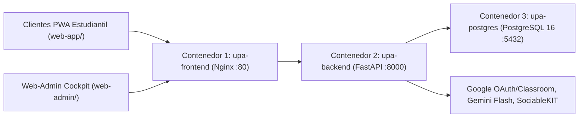
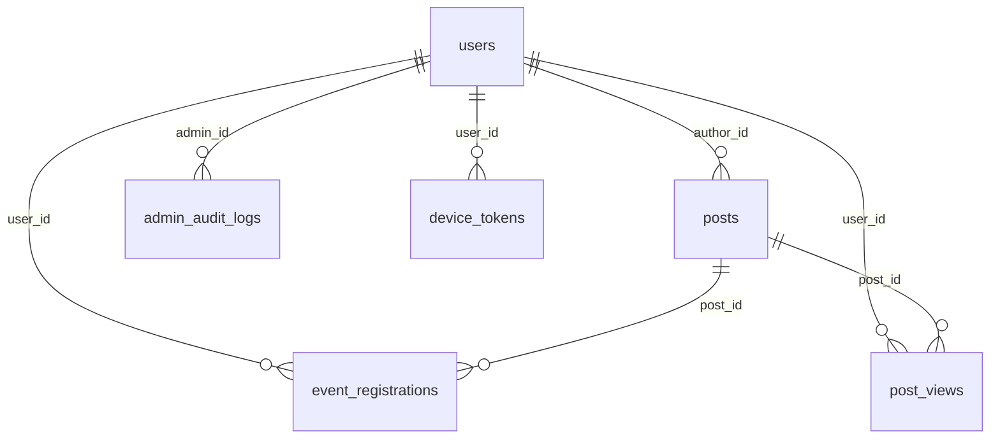

# UNIVERSIDAD PARAGUAYO ALEMANA (UPA)

==**Carrera:** Informática Empresarial (Business Informatics)==  
==**TRABAJO PRÁCTICO: ARQUITECTURA Y PLATAFORMA DIGITAL UNIVERSITARIA (UPA APP)**==

| Metadato | Detalle Institucional |
|---|---|
| **Institución** | ==Universidad Paraguayo Alemana (UPA), San Lorenzo, Paraguay== |
| **Proyecto** | ==UPA App: Plataforma Digital y Campus Móvil Centralizado== |
| **Repositorio Oficial** | ==`https://github.com/Pascal-Thommen/upa-app`== |
| **Autores** | ==Pascal Thommen, Natasha Colman y Equipo de Desarrollo UPA== |
| **Versión** | v3.1 (03 de noviembre de 2026) Basada en ==v3 (30 de octubre de 2026)== |

**Nota sobre el control de cambios visuales:** En el presente documento de arquitectura, todos los fragmentos, oraciones y párrafos resaltados con **fondo amarillo** corresponden al texto conservado de la **Versión v3 (30 de octubre de 2026)**. Los pasajes en texto estándar sin resaltado reflejan las actualizaciones arquitectónicas y correcciones técnicas consolidadas (adopción definitiva de Aplicación Web Progresiva en lugar de cliente nativo, separación de planteamiento del problema y solución, dimensionamiento para menos de 1.000 estudiantes, fundamentación de Python por sinergia con Inteligencia Artificial, operativa real de sincronización manual en SociableKIT Free Tier y esquema relacional depurado de 9 tablas).

## 1. Introducción y Resumen Ejecutivo (Executive Summary)

==El presente Trabajo Práctico documenta la concepción arquitectónica, la definición de alcance y el estado actual de desarrollo de la plataforma digital universitaria para la Universidad Paraguayo Alemana (UPA). Concebido desde la disciplina de la Informática Empresarial (Business Informatics) en la era de la inteligencia artificial y el desarrollo asistido, este documento no constituye un reporte de código manual ni un registro de tareas de programación, sino un informe técnico y estratégico de arquitectura ("del arquitecto hacia el propietario del sistema").==

==La iniciativa responde a una necesidad institucional crítica: la dispersión operativa de la información universitaria entre múltiples canales informales y plataformas desarticuladas (redes sociales, grupos de mensajería, aulas virtuales y portales administrativos).==

==El proyecto ha completado con éxito su fase de infraestructura base, backend y arquitectura de integración:==

1. ==Implementación de una base de datos relacional PostgreSQL gestionada mediante SQLAlchemy y Alembic==, depurada a exactamente 9 tablas productivas alineadas con `backend/src/models.py`.
2. ==Desarrollo de una API REST modular en FastAPI con documentación interactiva en `/docs` y arquitectura contenerizada de 3 servicios (Frontend Web-Admin Nginx, Backend API y base de datos PostgreSQL).==
3. ==Conexión y publicación segura del servidor mediante el proxy inverso de NetBird, garantizando acceso cifrado y público a través de internet.==
4. ==Integración de servicios externos clave (Google OAuth 2.0 institucional `@upa.edu.py`, Google Workspace Admin API, Google Classroom API y feed visual de Instagram mediante SociableKIT).==
5. Implementación del frontend estudiantil y docente como una **Aplicación Web Progresiva (Progressive Web App, PWA)** multiplataforma (`web-app/`) con página de aterrizaje de escritorio mediante código de respuesta rápida (Quick Response Code, QR), combinada con el portal administrativo **Web-Admin Cockpit** (`web-admin/`) asistido por **Inteligencia Artificial multimodal (Google Gemini Flash)**.

## 2. Definición del Problema, Solución Propuesta y Objetivos de Negocio

### 2.1 Planteamiento del Problema: Fragmentación Comunicacional en la UPA

La comunicación institucional en la Universidad Paraguayo Alemana (UPA), orientada a una comunidad de **menos de 1.000 estudiantes**, se encuentra fragmentada a través de grupos de WhatsApp, publicaciones en Instagram (`@upalemana`), correos electrónicos y cursos individuales en Google Classroom. Los anuncios importantes sobre eventos académicos o cancelaciones de clases se pierden con regularidad entre el flujo de mensajes informales. Debido a esta falta de alcance digital efectivo, el personal universitario se ve obligado en ocasiones a recorrer personalmente los pasillos y las aulas del edificio del campus para recordar de forma presencial a los estudiantes la realización de charlas, conferencias o actividades inminentes.

==En el ecosistema universitario contemporáneo de la UPA, la comunicación institucional padece de fragmentación multicanal:==

1. ==**Dispersión y pérdida de información crítica:** Los comunicados urgentes (como suspensión de clases o cambios edilicios) compiten con mensajes informales en grupos de WhatsApp, diluyendo su carácter oficial y generando incertidumbre.==
2. ==**Duplicidad de esfuerzos en difusión:** El equipo de comunicación y marketing genera contenido institucional de alto impacto visual en Instagram, el cual no se refleja de forma centralizada ni estructurada en los canales académicos oficiales.==
3. ==**Falta de canal formal de confirmación:** Las actividades extracurriculares, charlas y talleres carecen de un mecanismo ágil y centralizado de registro de asistencia (Répondez s'il vous plaît, RSVP), dificultando la planificación logística universitaria.==

### 2.2 Solución Propuesta: UPA App como Fuente Única de Verdad (Single Source of Truth)

==El objetivo central es consolidar un punto único de acceso (Single Source of Truth) para la comunidad estudiantil, integrando noticias oficiales, eventos institucionales, entregas académicas y alertas de emergencia== en una **Aplicación Web Progresiva (Progressive Web App, PWA)** de acceso inmediato y sin barreras de instalación en tiendas de aplicaciones.

El sistema sincroniza automáticamente las fechas límite de **Google Classroom** (con respaldo persistente en base de datos), incorpora el flujo visual de **Instagram (`@upalemana`)** y garantiza un acceso protegido mediante el inicio de sesión oficial de **Google Workspace (`@upa.edu.py`)**. Para el equipo de comunicación y administración, una interfaz **Web-Admin Cockpit** asistida por **Inteligencia Artificial multimodal (Google Gemini Flash)** extrae automáticamente datos de eventos a partir de afiches gráficos, minimizando el esfuerzo editorial para publicar anuncios y estableciendo el cimiento técnico para futuras funciones digitales del campus.

### 2.3 Objetivos Estratégicos del Proyecto

* ==**Centralización Institucional:** Establecer una única interfaz de referencia para la vida universitaria de directivos, docentes y alumnos.==
* ==**Integración sin Redundancia:** Conectar los sistemas ya consolidados en la UPA sin intentar reemplazarlos innecesariamente ni duplicar costos operativos.==
* ==**Seguridad y Control de Identidad:** Restringir el acceso exclusivamente a usuarios federados con cuentas institucionales `@upa.edu.py`.==
* ==**Escalabilidad y Sostenibilidad:** Diseñar una arquitectura desacoplada, documentada y de bajo costo de mantenimiento para la universidad.==

## 3. Delimitación del Alcance y Límites del Sistema (Scope Baseline)

### 3.1 Dentro del Alcance (In-Scope: Versión Productiva Actual)

1. ==**Autenticación y Seguridad Federada:**==
   * ==Inicio de sesión único (Single Sign-On, SSO) mediante Google OAuth 2.0 restringido estrictamente al dominio `@upa.edu.py`.==
   * ==Emisión y validación de tokens de sesión JWT (JSON Web Tokens).==
2. ==**Módulo de Publicaciones Unificadas (Feed y Comunicados):**==
   * ==Muro centralizado con soporte para tres formatos: noticias institucionales estándar, banners fijados de emergencia y publicaciones sociales.==
   * Integración del feed oficial de Instagram de la UPA (`@upalemana`) vía SociableKIT con descarga local de medios y extracción multimodal de eventos mediante IA.
   * ==Carga de imágenes y afiches mediante endpoint dedicado `/api/media/upload` con almacenamiento persistente en `/uploads`.==
3. ==**Módulo de Agenda y Eventos (Calendario Centralizado):**==
   * ==Visualización cronológica de eventos, charlas y talleres.==
   * ==Sistema interactivo de confirmación de asistencia (RSVP) con estados confirmados (`attending`) y cancelados (`declined`).==
   * ==Sincronización de fechas límites de entregas académicas desde Google Classroom API mediante tokens autorizados==, con renovación automática (`classroom_refresh_token`) y caché de respaldo en PostgreSQL (`classroom_deadlines_cache`).
4. ==**Segmentación y Control de Accesos (Role-Based Access Control, RBAC):**==
   * ==Clasificación de usuarios con perfiles diferenciados y una matriz de roles con permisos granulares== de 6 módulos (`publicaciones`, `grupos`, `roles`, `ia`, `apis`, `historial`) bajo el principio de mínimo privilegio.
   * ==Consulta de grupos institucionales mediante Google Workspace Admin Directory API para segmentación de avisos por carrera y semestre.==
   * ==Registro y auditoría inmutable de acciones administrativas en la tabla `admin_audit_logs`.==
5. ==**Panel de Gestión Web (Web-Admin CMS):**==
   * ==Interfaz web responsiva estructurada en== 6 módulos con enrutamiento profundo (`/dashboard/*`): ==Publicaciones (que unifica noticias y eventos)== e incluye el botón `Autocompletar con IA`, ==Grupos (sincronizados desde Google Workspace), Roles (matriz de permisos)==, Control de IA (clave y prompts de Google Gemini), APIs (diagnóstico en tiempo real) ==e Historial (registro de auditoría).==
6. **Frontend Móvil como Aplicación Web Progresiva (Progressive Web App, PWA):**
   * Aplicación Web Progresiva responsiva (`web-app/`) accesible directamente desde cualquier navegador móvil o de escritorio sin pasar por tiendas de aplicaciones.
   * Estructura de navegación en 3 vistas principales: **Inicio** (muro de comunicados, alertas urgentes, Instagram e inscripción RSVP de un toque), **Agenda** (calendario mensual y entregas de Google Classroom convertidas a `America/Asuncion`) y **Perfil** (identidad verificada `@upa.edu.py` y selector de 3 temas visuales).
   * Página de bienvenida en escritorio con simulación móvil interactiva y código QR vectorial dinámico para apertura e instalación inmediata en teléfonos Android e iOS.
   * Almacenamiento en caché de estructura mediante Trabajador de Servicio (`/sw.js` versión `1.0.3`), Manifiesto Web (`/manifest.webmanifest`) y caché local de datos por usuario.
7. ==**Infraestructura de Despliegue Seguro:**==
   * ==Contenerización desacoplada mediante Docker y Docker Compose estructurada en 3 servicios independientes: Frontend Web-Admin== y PWA ==(Nginx), Backend (FastAPI) y Base de Datos (PostgreSQL), junto con la disponibilidad de un entorno Beta aislado para pruebas.==
   * ==Publicación segura del servidor mediante el proxy inverso de NetBird, permitiendo el acceso público y cifrado desde internet a la API REST y al portal Web-Admin bajo dominio seguro== (`https://upa.eu1.netbird.services` en producción y `https://upa-beta.eu1.netbird.services` en beta).

## 4. Arquitectura del Sistema y Fundamentación de Decisiones ("El Porqué")

### 4.1 Frontend Móvil: Adopción de Aplicación Web Progresiva (Progressive Web App, PWA)

* **Decisión:** Implementar el cliente móvil para estudiantes y docentes íntegramente como una **Aplicación Web Progresiva (Progressive Web App, PWA)** multiplataforma (`web-app/`), servida sobre HTTPS con Manifiesto Web (`/manifest.webmanifest`) y Trabajador de Servicio (`/sw.js`).
* **Justificación técnica y estratégica:**
  * **Eliminación del costo y esfuerzo de publicación en tiendas (Zero Store Overhead):** El despliegue en Apple App Store y Google Play Store conlleva costos de licencias anuales, revisiones burocráticas y fricción de descarga para el alumno. Con la PWA, el esfuerzo de distribución en tiendas desaparece por completo: el estudiante accede al instante escaneando el código QR o abriendo el enlace institucional y puede instalar la aplicación en su pantalla de inicio (`display: "standalone"`).
  * **Accesibilidad universal en cualquier navegador y sistema operativo (Single Codebase):** La PWA es accesible desde cualquier navegador moderno con total independencia del sistema operativo (iOS en iPhone, Android, Windows, macOS o Linux). El sistema se desarrolla y mantiene una sola vez sobre estándares web abiertos, evitando duplicar el desarrollo en múltiples lenguajes propietarios.
  * **Actualizaciones instantáneas sin intervención del usuario (Instant Updates):** Cada mejora funcional o corrección publicada en el servidor entra en vigor de forma inmediata para todos los dispositivos mediante la actualización automática del Service Worker (`/sw.js` versión `1.0.3`), sin obligar al estudiante a descargar parches manualmente desde una tienda.
  * **Ausencia de requerimientos nativos pesados:** La mayoría de las ventajas exclusivas de una aplicación nativa tradicional (como el procesamiento gráfico 3D intensivo, el acceso directo a sensores de hardware específicos o servicios pesados permanentes en segundo plano) no resultan necesarios para el caso de uso real de la UPA App.
  * **Perspectiva de evolución (Notificaciones Push vía Firebase y Empaquetado para Tiendas):** Como opción futura en la hoja de ruta, el envío de notificaciones push incluso con la aplicación cerrada puede activarse mediante **Firebase Cloud Messaging (FCM)**, cuya lógica de despacho (`backend/src/services/push.py`) y tabla `device_tokens` ya se encuentran preparadas en el backend. Asimismo, si en una fase posterior la universidad desea listar la aplicación en Google Play Store o App Store, la PWA puede empaquetarse directamente como aplicación de tienda mediante **Actividad Web de Confianza (Trusted Web Activity, TWA)** utilizando el manifiesto `/.well-known/assetlinks.json` ya dispuesto en el proyecto.

### 4.2 Backend: Adopción de FastAPI (Python) frente a Java / Spring Boot

* ==**Decisión:** Se seleccionó FastAPI (`>=0.115.0`) sobre Python con servidor asíncrono Uvicorn en lugar de un stack tradicional basado en Java / Spring Boot.==
* ==**Justificación técnica y estratégica:**==
  * **Dimensionamiento realista para la UPA y sinergia con Inteligencia Artificial:** Dado el tamaño real de la comunidad universitaria (**menos de 1.000 estudiantes**), no tiene sentido técnico argumentar la elección del backend mediante métricas de rendimiento extremo o alta concurrencia masiva, puesto que cualquier tecnología moderna resuelve este volumen de usuarios sin esfuerzo. ==Por ende, el factor determinante fue maximizar la velocidad de prototipado e implementación.== Python es el lenguaje que la Inteligencia Artificial domina con mayor precisión y constituye el estándar nativo para integrar modelos multimodales como **Google Gemini Flash** (`backend/src/services/gemini.py` y `backend/src/services/ai_extractor.py`). ==FastAPI ofrece un desarrollo altamente ágil con una sintaxis concisa que integra de manera óptima y nativa con herramientas de desarrollo asistido por Inteligencia Artificial, acelerando de forma sustancial los ciclos de iteración.== Su estructura clara y breve permite que cualquier cambio o nueva función requerida por la universidad se adapte de forma rápida y dinámica.
  * ==**Validación estricta de datos mediante Pydantic v2:** La integración nativa con Pydantic v2 garantiza la validación estricta de tipos de datos de entrada y salida mediante esquemas declarativos, previniendo incoherencias y filtrando cargas maliciosas antes de alcanzar la capa de negocio.==

### 4.3 Base de Datos: Migración de SQLite a PostgreSQL con SQLAlchemy y Alembic

* ==**Decisión:** Implementación de PostgreSQL como motor relacional corporativo, gestionado mediante SQLAlchemy ORM (`>=2.0.35`) y migraciones automáticas con Alembic (`>=1.13.3`).==
* ==**Justificación técnica y estratégica:**==
  * ==**Concurrencia real de lectura y escritura:** SQLite implementa bloqueos a nivel de archivo para las operaciones de escritura. En un contexto universitario donde cientos de estudiantes confirman asistencia a eventos (RSVP) concurrentemente mientras los administradores publican avisos, SQLite generaría excepciones de contención (`database is locked`). PostgreSQL resuelve esto mediante MVCC (Multi-Version Concurrency Control), garantizando transacciones ACID simultáneas y sin bloqueos.==
  * ==**Integridad referencial y seguridad de datos:** PostgreSQL asegura la integridad mediante restricciones compuestas, reglas explícitas de `ON DELETE` (como `SET NULL` en autorías de publicaciones), claves foráneas e indexación optimizada de consultas sobre esquemas versionados con Alembic.==
  * ==**Evolución de esquema controlada:** Con Alembic, cada cambio estructural en las tablas queda registrado en el historial de código del repositorio, permitiendo auditorías y migraciones reproducibles sin riesgo de pérdida de datos.==

### 4.4 Integraciones Externas: Principio de Integración frente a Reinvención y Operativa Real de SociableKIT

* ==**Decisión:** Integración de SociableKIT (Instagram), Google Workspace Admin y Google Classroom.==
* ==**Justificación técnica y estratégica:**==
  * ==**Instagram vía SociableKIT:** El equipo de marketing de la UPA ya produce contenido visual activo y de calidad en Instagram. Programar un módulo de publicación social propio en la app universitaria resultaría en un costo redundante y duplicaría el trabajo editorial. Integrar el feed existente conecta la app directamente a la vida universitaria activa sin esfuerzo administrativo adicional.== **Operativa real de sincronización en el plan gratuito (Free Tier):** El backend (`backend/src/services/instagram.py`) consume a través de una API HTTP el flujo JSON generado por SociableKIT para la cuenta `@upalemana` (`SOCIABLEKIT_WIDGET_ID = 25723525`). Dado que el proyecto utiliza la versión gratuita (Free Tier) sin pago mensual, SociableKIT no actualiza su caché desde Instagram de manera automática en tiempo real; por ello, cuando se publica un post nuevo en Instagram y se requiere su ingesta inmediata, primero se debe pulsar manualmente el botón de sincronización en el panel web de SociableKIT y posteriormente accionar `Sincronizar Instagram` en el Web-Admin Cockpit. Durante esa ingesta, el backend descarga localmente las imágenes en `/uploads` y ejecuta el extractor multimodal con **Google Gemini Flash** para detectar automáticamente fechas y horarios de eventos en los afiches.
  * ==**Google Workspace OAuth 2.0:** Toda la comunidad UPA cuenta con identidad digital institucional bajo `@upa.edu.py`. Desarrollar un sistema de registro propio con almacenamiento de contraseñas acarrearía responsabilidades graves de seguridad, costos de infraestructura SMTP y problemas operativos de recuperación de cuentas. OAuth delega la seguridad en la infraestructura de Google y garantiza que solo miembros verificados de la UPA accedan al sistema.==
  * ==**Google Classroom API:** Sincroniza directamente las tareas y fechas de entrega con el calendario de la app móvil, eliminando la necesidad de que los estudiantes consulten múltiples plataformas para conocer sus plazos académicos.==

### 4.5 Infraestructura y Seguridad: Conectividad Zero-Trust mediante NetBird

* ==**Decisión:** Acceso seguro y publicación de servicios de la API y la web mediante la red de acceso seguro Zero-Trust de NetBird (disponible en `https://upa.eu1.netbird.services/dashboard/`).==
* ==**Justificación técnica y estratégica:**==
  * ==**Seguridad perimetral Zero-Trust y exposición pública controlada:** NetBird permite hacer accesibles públicamente la API REST y el portal web mediante un modelo de red overlay Zero-Trust. Esto garantiza una conectividad directa, cifrada de extremo a extremo y restringida granularmente por políticas de identidad para administrar y acceder a los servicios (`https://upa.eu1.netbird.services/dashboard/`).==
  * ==Adicionalmente, esta solución resuelve de manera pragmática y segura los desafíos operacionales propios del entorno de desarrollo (como el alojamiento transitorio en un servidor local/casero sin IP pública fija) durante esta etapa del proyecto. Se destaca que esta infraestructura representa un entorno de staging robusto pero provisorio para la fase actual, manteniendo total flexibilidad para la posterior migración al hosting productivo definitivo que determine la universidad.==

### 4.6 Modelo de Dominio: Fuente Única de Verdad (Unified Post Model) y Diagrama de Arquitectura

* ==**Decisión:** Modelo relacional unificado `Post` para gestionar noticias, eventos y alertas urgentes.==
* ==**Justificación técnica y estratégica:**==
  * ==**Flexibilidad editorial y reducción de redundancia:** En la comunicación universitaria, los eventos son a menudo también noticias y pueden requerir ser destacados como avisos prioritarios (`is_news`, `is_event`, `is_pinned`). Mantener entidades separadas obligaría a redundancia de datos. El modelo unificado simplifica la persistencia y la consulta a través de endpoints consolidados== (`/api/v1/feed`, `/api/v1/agenda` y `/api/publications`).



### 4.7 Frontend Web-Admin y PWA: Desacoplamiento en Contenedor Nginx Independiente

* ==**Decisión:** Separar el frontend del portal Web-Admin== y de la PWA estudiantil ==en un contenedor Nginx propio e independiente de la API backend.==
* ==**Justificación técnica y estratégica:**==
  * ==**Optimización del rendimiento y recursos:** Nginx es altamente eficiente para servir recursos estáticos y gestionar solicitudes web simples, liberando al proceso asíncrono de FastAPI de la carga de entrega web para centrarlo exclusivamente en el procesamiento de la lógica de negocio y endpoints REST.==
  * ==**Aislamiento y seguridad:** El desacoplamiento de contenedores reduce la superficie de ataque, permitiendo escalar, mantener y actualizar el portal Web-Admin sin interrumpir los servicios de la API.==

## 5. Esquema de Base de Datos Depurado (`backend/src/models.py`)

### 5.1 Depuración de Columnas Huérfanas y Resumen de las 9 Tablas Productivas

El esquema relacional en PostgreSQL 16 fue auditado mediante migraciones de Alembic para eliminar todas las columnas obsoletas o no utilizadas por el código productivo (como el antiguo campo individual `device_token` en `users`, normalizado ahora en la tabla `device_tokens`). La base de datos consta exactamente de las **9 tablas reales** definidas en `backend/src/models.py`:

| # | Tabla SQL | Clave Primaria / Restricciones Únicas | Columnas Productivas (`backend/src/models.py`) | Propósito en el Sistema |
|---|---|---|---|---|
| 1 | `users` | `PK: id` <br> `UK: email` | `id`, `email`, `full_name`, `role`, `groups`, `google_groups`, `classroom_token`, `classroom_refresh_token`, `classroom_deadlines_cache`, `classroom_synced_at`, `created_at`, `updated_at` | Identidad `@upa.edu.py`, grupos sincronizados y tokens/caché de Google Classroom. |
| 2 | `posts` | `PK: id` <br> `UK: instagram_id` <br> `FK: author_id -> users.id` | `id`, `title`, `caption`, `content`, `post_type`, `category`, `is_news`, `is_event`, `is_pinned`, `published_at`, `expires_at`, `event_start`, `event_end`, `location`, `target_groups`, `has_registration`, `send_push_notification`, `reminders`, `notify_groups`, `event_notify_groups`, `link_url`, `link_label`, `is_edited`, `is_ai_generated`, `instagram_id`, `media_type`, `media_url`, `permalink`, `author_id`, `created_at`, `updated_at` | Fuente Única de Verdad para noticias, eventos, banners urgentes y posts de Instagram. |
| 3 | `event_registrations` | `PK: id` <br> `UK: (post_id, user_id)` | `id`, `post_id`, `user_id`, `status`, `created_at`, `updated_at` | Confirmaciones (`attending`) y bajas (`declined`) de asistencia a eventos (RSVP). |
| 4 | `post_views` | `PK: id` <br> `UK: (post_id, user_id)` | `id`, `post_id`, `user_id`, `viewed_at` | Conteo único de lecturas por usuario y publicación para métricas de alcance. |
| 5 | `admin_audit_logs` | `PK: id` <br> `FK: admin_id -> users.id` | `id`, `admin_id`, `action`, `target_type`, `target_id`, `target_key`, `details`, `created_at` | Bitácora inmutable de auditoría administrativa con diferencias campo por campo. |
| 6 | `device_tokens` | `PK: id` <br> `UK: (user_id, device_token)` | `id`, `user_id`, `device_token`, `platform`, `created_at`, `updated_at` | Registro multi-dispositivo de tokens Firebase Cloud Messaging (FCM). |
| 7 | `audience_groups` | `PK: id` (`String(50)`) | `id`, `name`, `description`, `google_groups`, `emails`, `created_at`, `updated_at` | Grupos de segmentación (`ALL`, `estudiantes`, `docentes`, `TIE`, `PI`, `TI`) y mapeo con Google Workspace. |
| 8 | `user_roles` | `PK: id` <br> `UK: email` | `id`, `email`, `name`, `permissions`, `is_primary`, `created_at`, `updated_at` | Matriz RBAC de 6 permisos granulares (`publicaciones`, `grupos`, `roles`, `ia`, `apis`, `historial`). |
| 9 | `app_settings` | `PK: key` (`String(100)`) | `key`, `value`, `updated_by`, `updated_at` | Configuración global persistente en PostgreSQL (clave API y prompts de Gemini). |

### 5.2 Diagrama Entidad-Relación (Entity-Relationship Diagram, ERD)



### 5.3 Código del Modelo en Formato DBML para Ordenamiento Visual (`https://dbdiagram.io/d`)

Para ordenar visualmente las cajas de las 9 tablas y exportar el diagrama a medida, se puede pegar el siguiente código **DBML (Database Markup Language)** directamente en la herramienta web gratuita **`https://dbdiagram.io/d`**:

```dbml
// Esquema Relacional Productivo UPA App (PostgreSQL 16 - backend/src/models.py)
// Pegar directamente en: https://dbdiagram.io/d

Table users {
  id int [pk, increment]
  email varchar(255) [unique, not null]
  full_name varchar(255) [not null]
  role varchar(50) [not null, default: 'user']
  groups json [not null, default: '[]']
  google_groups json [not null, default: '[]']
  classroom_token text [null]
  classroom_refresh_token text [null]
  classroom_deadlines_cache json [not null, default: '[]']
  classroom_synced_at timestamptz [null]
  created_at timestamptz [not null]
  updated_at timestamptz [null]
}

Table posts {
  id int [pk, increment]
  title varchar(255) [not null]
  caption text [null]
  content text [null]
  post_type varchar(50) [not null, default: 'MANUAL']
  category varchar(50) [null]
  is_news boolean [not null, default: true]
  is_event boolean [not null, default: false]
  is_pinned boolean [not null, default: false]
  published_at timestamptz [null]
  expires_at timestamptz [null]
  event_start timestamptz [null]
  event_end timestamptz [null]
  location varchar(255) [null]
  target_groups json [not null, default: '[]']
  has_registration boolean [not null, default: false]
  send_push_notification boolean [not null, default: false]
  reminders json [null]
  notify_groups json [null]
  event_notify_groups json [null]
  link_url text [null]
  link_label varchar(100) [null]
  is_edited boolean [not null, default: false]
  is_ai_generated boolean [not null, default: false]
  instagram_id varchar(100) [unique, null]
  media_type varchar(50) [null]
  media_url text [null]
  permalink text [null]
  author_id int [ref: > users.id, null]
  created_at timestamptz [not null]
  updated_at timestamptz [null]
}

Table event_registrations {
  id int [pk, increment]
  post_id int [ref: > posts.id, not null]
  user_id int [ref: > users.id, not null]
  status varchar(50) [not null, default: 'attending']
  created_at timestamptz [not null]
  updated_at timestamptz [null]
}

Table post_views {
  id int [pk, increment]
  post_id int [ref: > posts.id, not null]
  user_id int [ref: > users.id, not null]
  viewed_at timestamptz [not null]
}

Table admin_audit_logs {
  id int [pk, increment]
  admin_id int [ref: > users.id, not null]
  action varchar(100) [not null]
  target_type varchar(50) [not null]
  target_id int [null]
  target_key varchar(255) [null]
  details json [not null, default: '{}']
  created_at timestamptz [not null]
}

Table device_tokens {
  id int [pk, increment]
  user_id int [ref: > users.id, not null]
  device_token varchar(512) [not null]
  platform varchar(50) [not null, default: 'android']
  created_at timestamptz [not null]
  updated_at timestamptz [not null]
}

Table audience_groups {
  id varchar(50) [pk]
  name varchar(100) [not null]
  description text [null]
  google_groups json [null]
  emails json [not null]
  created_at timestamptz [not null]
  updated_at timestamptz [null]
}

Table user_roles {
  id int [pk, increment]
  email varchar(255) [unique, not null]
  name varchar(255) [not null]
  permissions json [not null]
  is_primary boolean [not null, default: false]
  created_at timestamptz [not null]
  updated_at timestamptz [null]
}

Table app_settings {
  key varchar(100) [pk]
  value text [not null]
  updated_by varchar(255) [null]
  updated_at timestamptz [not null]
}
```

## 6. Estado de Avance y Resultados Operativos

==Durante el último ciclo de desarrollo, el equipo ha alcanzado los siguientes hitos verificables en el repositorio:==

### 6.1 Infraestructura y Backend

* ==**Base de Datos PostgreSQL Conectada:** Base de datos relacional PostgreSQL plenamente operativa en contenedor Docker, con esquemas de tablas sincronizados y versionados con Alembic.==
* ==**API REST Modular Implementada:** Conjunto completo de endpoints REST organizados en routers independientes== (`/api/auth`, `/api/users`, `/api/v1/feed`, `/api/v1/agenda`, `/api/events`, `/api/publications`, `/api/classroom`, `/api/groups`, `/api/roles`, `/api/ai`, `/api/media`, `/api/history` y `/api/system/diagnostics`), ==con serialización y validación estricta en Pydantic.==
* ==**Documentación Interactiva OpenAPI:** Especificación OpenAPI== 3.1 ==funcional y accesible en `/docs`, permitiendo la auditoría y prueba funcional directa de cada endpoint.==
* ==**Despliegue y Conexión de Servidor con NetBird:** Servidor de staging== y producción ==implementado sobre infraestructura contenerizada y accesible de forma segura mediante la red Zero-Trust de NetBird para pruebas de integración.==

### 6.2 Integraciones Externas Validadas

* ==**Integración del Feed de Instagram:** Conector operativo con SociableKIT para la agregación== de publicaciones institucionales (`@upalemana`) dentro del feed unificado tras la sincronización manual en el panel gratuito de SociableKIT, con descarga local de imágenes y análisis multimodal de eventos con Google Gemini Flash.
* ==**Gestión de Identidad y Roles con Google Workspace:**==
  * ==Flujo de inicio de sesión con Google OAuth 2.0 restringido al dominio `@upa.edu.py`.==
  * ==Detección y mapeo de grupos de Google para asignación automática de carrera y semestre.==
* ==**Sincronización de Google Classroom:** Conexión con la API de Classroom para la lectura de cursos y extracción de fechas de entrega de tareas hacia la agenda del estudiante==, respaldada con renovación automática de tokens y caché en base de datos.

### 6.3 Funciones Principales Operativas

* ==**Gestión Unificada de Noticias y Eventos:** Endpoints CRUD para la creación== y edición unificada en `/api/publications`, ==expiración de avisos y fijado de comunicados urgentes.==
* ==**Gestión de Asistencia a Eventos (RSVP):** Tabla `event_registrations` funcional para registrar asistencia o baja de eventos con restricción de unicidad por usuario.==
* ==**Control de Acceso Basado en Roles (RBAC):** Matriz de roles con permisos granulares== (`publicaciones`, `grupos`, `roles`, `ia`, `apis`, `historial`) ==y registro inmutable de auditoría administrativa en `admin_audit_logs`.==
* ==**Servicio de Carga Multimedia:** Endpoint `/api/media/upload` habilitado para almacenar afiches universitarios, sirviéndolos de manera estática y segura desde `/uploads`.==

### 6.4 Frontend y Herramientas Administrativas

* ==**Cockpit Editorial Web-Admin:** Portal web de administración estructurado en== 6 módulos operativos (`Publicaciones` con autocompletado multimodal por IA, `Grupos`, `Roles`, `Control de IA`, `APIs` e `Historial`) ==para la gestión integral de contenidos y gobernanza institucional.==
* **Aplicación Web Progresiva Estudiantil (PWA):** Cliente móvil y de escritorio plenamente operativo en producción (`web-app/`), equipado con página de aterrizaje con código QR dinámico, pestañas de `Inicio`, `Agenda` y `Perfil`, Service Worker (`v1.0.3`) y soporte de instalación directa en pantalla de inicio sin fricción de tiendas de aplicaciones.
