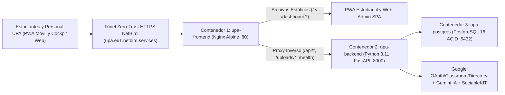

# UNIVERSIDAD PARAGUAYO ALEMANA (UPA)

**Carrera:** Informática Empresarial (Business Informatics)  
**Documento:** Parte 3 de la Documentación del Proyecto: Informe Final del Proyecto y Cuestionario de Evaluación ("Entrega final del curso")

| Metadato | Detalle Institucional |
|---|---|
| **Institución** | Universidad Paraguayo Alemana (UPA), San Lorenzo, Paraguay |
| **Proyecto** | UPA App: Plataforma Digital y Campus Móvil Centralizado |
| **Documento** | Informe del Proyecto y Respuestas al Cuestionario de Entrega Final |
| **Repositorio Oficial** | `https://github.com/Pascal-Thommen/upa-app` |
| **Entorno Productivo** | `https://upa.eu1.netbird.services` (PWA y Web-Admin Cockpit) |
| **Equipo del Proyecto** | Pascal Thommen, Theresa Bauer y Natasha Colman |
| **Versión y Fecha** | v4.0 (03 de noviembre de 2026) |

## Sección 1: Descripción del Proyecto y Público Objetivo (Project Description and Target Audience)

### 1.1 Resumen Ejecutivo en Máximo 2 Líneas (Elevator Pitch de la PWA)

> **UPA App** es la Aplicación Web Progresiva (Progressive Web App, PWA) centralizada de la Universidad Paraguayo Alemana que unifica avisos oficiales, eventos con inscripción en un clic, entregas de Google Classroom e Instagram en un único acceso móvil (`@upa.edu.py`), gestionado desde un panel web asistido por Inteligencia Artificial (Artificial Intelligence, IA).

### 1.2 Explicación Detallada del Producto en Máximo 10 Líneas

**UPA App** resuelve la dispersión informativa del campus reuniendo en una **Fuente Única de Verdad (Single Source of Truth)** toda la actividad académica e institucional para una comunidad de menos de 1.000 estudiantes. Los alumnos y docentes ingresan de inmediato desde cualquier navegador móvil (Android o iOS) escaneando un código de respuesta rápida (Quick Response Code, QR) sin pasar por tiendas de aplicaciones, autenticándose con su cuenta oficial `@upa.edu.py` mediante Google OAuth 2.0. En la aplicación consultan comunicados filtrados por carrera, alertas urgentes, publicaciones oficiales de Instagram (`@upalemana`), confirman su asistencia a eventos con un toque (`Sí, asistiré` / `No asistiré`) y visualizan sus fechas límite personales de Google Classroom integradas en el calendario mensual. En paralelo, el equipo de Marketing y Administración opera el **Web-Admin Cockpit** (`/dashboard/`), donde administra publicaciones, grupos de audiencia, roles de permisos y auditoría, apoyándose en el botón `Autocompletar con IA` (Google Gemini multimodal) para transformar afiches gráficos en eventos estructurados en segundos.

### 1.3 Comparativa del Público Objetivo: Estudiantes y Personal frente al Caos Multicanal

#### A. Propuesta de Valor Diferenciada por Perfil de Usuario

| Perfil de Usuario | Situación Previa (Caos Multicanal) | Valor Real Aportado por UPA App |
|---|---|---|
| **Estudiantes de Grado (`@upa.edu.py`)** | Información dispersa entre grupos informales de WhatsApp, feed algorítmico de Instagram, correos electrónicos no leídos y materias aisladas en Google Classroom. Pérdida frecuente de fechas de entrega, cambios de aula o charlas. | Prevención directa de pérdida de plazos y eventos. Consulta centralizada de avisos segmentados por carrera (`TIE`, `PI`, `TI`), inscripción a eventos en 1 clic y calendario unificado con respaldo persistente de tareas de Classroom. |
| **Cuerpo Docente y Coordinación** | Desconocimiento de eventos generales del campus y falta de visibilidad sobre qué comunicados institucionales llegaron efectivamente a sus alumnos. | Acceso inmediato a la agenda institucional consolidada y recepción de avisos específicos para el grupo `docentes` desde cualquier teléfono o computadora. |
| **Personal de Marketing y Administración** | Obligación de publicar manualmente el mismo anuncio en múltiples redes, nula visibilidad previa del aforo de eventos y necesidad de recorrer físicamente las aulas del edificio para recordar charlas inminentes. | Carga única asistida por IA multimodal (`Autocompletar con IA`), lectura en tiempo real de listas nominales de asistentes confirmados (RSVP) y gobernanza granular con bitácora de auditoría. |

#### B. Estado de Validación: Hechos Verificados frente a Supuestos Abiertos

* **Aspectos Verificados Empíricamente:**
  1. **Existencia real del problema en el campus:** Se confirmó con estudiantes y personal que los avisos importantes se pierden en WhatsApp y correo, obligando en ocasiones al personal a avisar presencialmente aula por aula.
  2. **Preferencia por acceso web instantáneo (PWA) sin tiendas:** Los usuarios de prueba en dispositivos Android e iPhone valoraron abrir la plataforma directamente mediante código QR o enlace web sin descargar paquetes pesados desde App Store o Play Store.
  3. **Ahorro operativo del autocompletado con IA:** En pruebas reales con afiches de la UPA, el asistente multimodal extrae título, fecha, hora y lugar en pocos segundos, eliminando la transcripción manual para el equipo de Marketing.
  4. **Resiliencia del calendario estudiantil:** La conversión horaria a `America/Asuncion` y el caché en base de datos (`classroom_deadlines_cache`) garantizan que las entregas de Classroom nunca desaparezcan de la agenda del alumno.
* **Supuestos Abiertos (Pendientes de Validación en Operación Semestral Completa):**
  1. **Frecuencia de consulta espontánea sin notificaciones push:** Está por medirse la tasa de apertura diaria de los estudiantes durante todo un semestre antes de activar las notificaciones push nativas en segundo plano.
  2. **Adopción transversal fuera de Marketing:** Queda por validar la velocidad con la que todas las secretarías académicas abandonarán el envío de anuncios por WhatsApp para publicar exclusivamente desde el Web-Admin Cockpit.

## Sección 2: Evolución del Proyecto: Idea Original frente a la Realidad (Project Evolution)

### 2.1 Las 3 Modificaciones Estratégicas Fundamentales del Proyecto

Durante el ciclo de ingeniería, el proyecto experimentó tres giros estratégicos deliberados para maximizar el valor funcional real entregado a la universidad:

1. **Cambio 1: De Aplicación Nativa Android a Aplicación Web Progresiva (PWA):**
   * **Idea inicial:** Construir un cliente móvil exclusivo para el sistema operativo Android.
   * **Decisión ejecutada y justificación:** Se reemplazó el enfoque nativo por una **Aplicación Web Progresiva (Progressive Web App, PWA)** universal (`web-app/` con Service Worker `/sw.js` y `/manifest.webmanifest`). Esta transición eliminó la barrera burocrática y los costos de publicación en tiendas (Google Play Store y Apple App Store, que exige equipo Mac y membresía anual de 99 USD), resolvió de inmediato la compatibilidad para la gran cantidad de estudiantes de la UPA que utilizan iPhone (iOS) y permitió actualizaciones instantáneas en el navegador sin exigir descargas manuales.
2. **Cambio 2: Postergación de las Notificaciones Push vía Firebase Cloud Messaging:**
   * **Idea inicial:** Entregar notificaciones emergentes en vivo en los teléfonos móviles desde la primera iteración.
   * **Decisión ejecutada y justificación:** Aunque el servicio de despacho en el backend (`backend/src/services/push.py`) y la tabla relacional multi-dispositivo (`device_tokens`) quedaron íntegramente programados y probados, la configuración activa de credenciales Firebase en los clientes móviles se pospuso por limitaciones de tiempo y restricciones técnicas en la computadora portátil de trabajo. Se priorizó realizar un corte arquitectónico limpio y entregar un sistema núcleo 100 % estable en lugar de una integración push a medio terminar.
3. **Cambio 3: Expansión del Panel Web-Admin con Inteligencia Artificial Multimodal:**
   * **Idea inicial:** Un formulario básico de administración para redactar comunicados manualmente.
   * **Decisión ejecutada y justificación:** La idea surgió directamente del diálogo con el departamento de Marketing de la UPA, quienes explicaron que su flujo diario gira en torno a diseñar afiches visuales para Instagram. A partir de esa necesidad real se diseñó el **Web-Admin Cockpit** completo con el asistente `Autocompletar con IA` y la extracción automática de eventos desde Instagram mediante modelos multimodales de Google Gemini, convirtiendo flyers gráficos en eventos de calendario con inscripción activa sin doble carga manual.

### 2.2 Matriz de Nivel de Madurez del Sistema (Maturity Matrix)

| Módulo / Capacidad del Sistema | Estado de Madurez | Detalle Técnico de Implementación Real |
|---|---|---|
| **Autenticación Institucional (`@upa.edu.py`)** | **100 % Completado** | Inicio de Sesión Único (SSO) con Google OAuth 2.0, restricción estricta de dominio `@upa.edu.py`, tokens JWT firmados y protección de privacidad de grupos para estudiantes. |
| **Muro de Campus (Feed PWA) y Alertas** | **100 % Completado** | Flujo unificado en `web-app/` con avisos urgentes fijados (`is_pinned`) con expiración automática (`expires_at`), noticias, tarjetas de Instagram, filtros y conteo único de lecturas (`post_views`). |
| **Inscripción a Eventos en 1 Clic (RSVP)** | **100 % Completado** | Confirmación y baja instantánea (`Sí, asistiré` / `No asistiré`) en tarjetas y agenda, persistida en `event_registrations` con consulta de lista nominal de inscritos en el Cockpit. |
| **Sincronización con Google Classroom** | **100 % Completado** | Lectura en vivo de cursos y entregas del alumno, renovación automática con `classroom_refresh_token` y respaldo persistente en PostgreSQL (`classroom_deadlines_cache`). |
| **Web-Admin Cockpit y Gobernanza RBAC** | **100 % Completado** | Portal en `/dashboard/` con enrutamiento profundo (Deep Linking `/dashboard/publicaciones/:id`), gestión de grupos Workspace, matriz de 6 permisos (`publicaciones`, `grupos`, `roles`, `ia`, `apis`, `historial`), diagnóstico en vivo y auditoría inmutable (`admin_audit_logs`). |
| **Extracción Multimodal con IA (`Autocompletar con IA`)** | **100 % Completado** | Integración multimodal con Google Gemini Flash (y respaldo automático en Gemma 4), optimización de imágenes a `768px`, temperatura `0.0`, reglas contra alucinaciones (Zero-Hallucination Grounding) y autocompletado exclusivo de campos vacíos. |
| **Sincronización de Instagram vía SociableKIT** | **Parcialmente Implementado** | El backend descarga imágenes localmente y extrae eventos con IA automáticamente, pero al utilizar el plan gratuito (Free Tier) de SociableKIT sin licencia comercial de Meta, requiere pulsar manualmente el botón de sincronización en el panel de SociableKIT para refrescar posts nuevos. |
| **Manejo de Archivos de Video (Video-Handling)** | **Parcialmente Implementado** | Soporta subida validada y reproducción nativa de archivos `MP4` y `WEBM` hasta `10 MB` y enlaces a Reels de Instagram, pero no incluye recodificación adaptativa en servidor para videos pesados de larga duración. |
| **Notificaciones Push en Vivo (Firebase FCM)** | **Abierto / Pendiente** | La lógica backend (`push.py`) y la tabla `device_tokens` están listas; falta vincular el proyecto activo de Firebase y activar la suscripción push en el cliente móvil. |
| **Alojamiento en Servidor Oficial de la UPA** | **Abierto / Pendiente** | El sistema opera hoy en un entorno Docker productivo propio expuesto vía túnel cifrado NetBird (`upa.eu1.netbird.services`); resta su mudanza física/nube al servidor institucional de la UPA. |

## Sección 3: Desarrollo Técnico, Calidad de Software y Aprendizajes (Technical Execution and Learnings)

### 3.1 Interacción Arquitectónica en Nivel de Gestión (Management-Level Architecture)

Desde una perspectiva de gestión tecnológica, la plataforma evita arquitecturas monolíticas frágiles o costos de nube descontrolados mediante el trabajo coordinado de cuatro capas desacopladas:

1. **Túnel Zero-Trust NetBird (`upa.eu1.netbird.services`):** Proporciona cifrado TLS de extremo a extremo y exposición pública segura hacia internet sin abrir puertos entrantes riesgosos en la red del servidor.
2. **Servidor Frontal y Proxy Inverso Nginx (`upa-frontend`):** Entrega de manera instantánea los archivos estáticos de la PWA estudiantil (`/`) y del panel administrativo (`/dashboard/`), y enruta internamente las peticiones `/api/*` y `/uploads/*` hacia el backend bajo el mismo dominio (Same-Origin), erradicando errores de permisos cruzados (CORS) y bloqueos por contenido mixto (Mixed Content).
3. **Núcleo de Negocio en FastAPI (`upa-backend`):** Servicio en Python 3.11+ que centraliza las reglas institucionales, valida cada entrada y salida con Pydantic v2, aplica la matriz de 6 permisos RBAC y coordina las integraciones con Google OAuth 2.0, Google Classroom, SociableKIT y la IA multimodal de Google Gemini.
4. **Persistencia Transaccional en PostgreSQL 16 (`upa-postgres`):** Base de datos relacional aislada en la interfaz local (`127.0.0.1:5432`) con 9 tablas depuradas y gestionadas mediante SQLAlchemy 2.0 y migraciones versionadas en Alembic, asegurando integridad ACID incluso cuando decenas de alumnos se inscriben simultáneamente a un evento.

### 3.2 Mayor Dificultad y Error Crítico del Proyecto: Del Uso Inicial de Gemini Flash al Cambio Estricto a Gemini 4 Argon y TDD

* **El error inicial de desarrollo:** En la fase temprana del proyecto se cometió el error de utilizar **Gemini Flash** como asistente para generar y modificar código fuente. Debido a las limitaciones de razonamiento profundo de los modelos ligeros tipo Flash, se introdujeron problemas severos de calidad de código, inconsistencias entre esquemas del backend y llamadas del frontend, funciones incompletas y alucinaciones técnicas que consumieron tiempo valioso de depuración.
* **La decisión correctiva:** Se estableció una regla de gobernanza estricta que prohibió por completo el uso de modelos Flash o DeepSeek para programar. Toda la ingeniería de software se migró exclusivamente a **Gemini 4 Argon** combinada con **Desarrollo Guiado por Pruebas (Test-Driven Development, TDD)** y auditoría estática automatizada. *(Nota arquitectónica: El modelo ligero Gemini Flash se conserva únicamente como servicio interno en tiempo de ejecución dentro del backend para leer afiches gráficos en segundos, mientras que el diseño y escritura del código del repositorio se ejecuta exclusivamente con Gemini 4 Argon).*

### 3.3 Aseguramiento de la Calidad: Doctrina Zero-Mock y Suite Automatizada

La estabilidad de la plataforma se garantiza mediante tres barreras técnicas obligatorias que se ejecutan antes de aceptar cualquier cambio:

1. **Doctrina Cero Mocks (`scripts/audit_zero_mock.py`):** Escáner estático de gobernanza que bloquea cualquier intento de introducir datos falsos en producción, banderas de evasión (`MOCK_MODE`, `SKIP_AUTH`), funciones vacías (`pass`, `NotImplementedError`) o pruebas aparentes sin aserciones reales (Scheintests). Toda la lógica de negocio y persistencia se prueba contra bases de datos reales; las simulaciones controladas se permiten únicamente para recrear caídas o tiempos de espera agotados (timeouts) de servicios externos como Google, Gemini o SociableKIT.
2. **Suite Automatizada de 231+ Pruebas en Pytest y Pruebas Web:** El proyecto mantiene **231+ pruebas automatizadas en Pytest** (actualmente 232 pruebas activas entre `backend/tests/` y `tests/test_audit_zero_mock.py`) junto con suites de pruebas de unidad y extremo a extremo (DOM E2E) en Node.js para la PWA (`web-app/tests`, 27 pruebas) y el Web-Admin Cockpit (`web-admin/tests`, 15 pruebas).
3. **Tipado Estático y Linting Estricto:** Verificación de tipos al 100 % con **Pyright** (`0 errors, 0 warnings`) sobre el backend Python y control de calidad de código con **Ruff** (`All checks passed!`).

### 3.4 Herramientas de Inteligencia Artificial en el Flujo de Ingeniería

* **Orquestación Autónoma con Multica y Gemini 4 Argon:** El desarrollo se gestionó mediante la plataforma **Multica**, delegando paquetes de trabajo estructurados (Issues con criterios de aceptación verificables) al agente de ingeniería impulsado por **Gemini 4 Argon**.
* **Protocolo de Verificación en Ciclo Cerrado (`auto_ship`):** Cada requerimiento siguió un flujo disciplinado de dos fases (análisis e implementación real). Ningún código llega al repositorio principal (`main`) sin haber aprobado previamente en la terminal local el 100 % de la batería de pruebas (`pytest`, `pyright`, `ruff check`, pruebas JS de PWA/Cockpit y `audit_zero_mock.py`), tras lo cual se automatiza la creación del Pull Request, la fusión (Squash-Merge) y la reconstrucción de los contenedores Docker.

## Sección 4: Continuidad del Proyecto y Hoja de Ruta (Project Continuation and Roadmap)

### 4.1 Hoja de Ruta a 30 Días: Preparación para el Lanzamiento Oficial (Go-Live Readiness)

El plan de transición para los próximos 30 días se enfoca en transferir la plataforma desde el entorno de demostración hacia la infraestructura definitiva de la universidad:

1. **Despliegue en Servidor Oficial de la UPA:** Instalación de la pila de tres contenedores Docker (`upa-frontend`, `upa-backend`, `upa-postgres`) en el servidor institucional provisto por el departamento de TI de la UPA, configurando volúmenes persistentes y copias de seguridad diarias automatizadas de PostgreSQL.
2. **Activación del Dominio Institucional `app.upa.edu.py`:** Configuración de los registros DNS institucionales y certificados TLS/HTTPS automáticos para que estudiantes y personal accedan a través de `https://app.upa.edu.py`.
3. **Licenciamiento Oficial de Meta Graph API:** Reemplazo del conector gratuito de SociableKIT por una conexión directa con la API oficial de Meta (Instagram Graph API) utilizando el token de cuenta comercial verificada de `@upalemana`, logrando sincronización 100 % automática sin intervención manual.
4. **Activación de Notificaciones Push con Firebase (FCM):** Conexión de las credenciales productivas de Firebase Cloud Messaging con el módulo `backend/src/services/push.py` ya existente para emitir alertas instantáneas al teléfono ante avisos urgentes o recordatorios de eventos.

### 4.2 Hoja de Ruta a 6 Meses: Profundización Funcional e Integración con UPA Académico

En un horizonte de 6 meses, la arquitectura modular de la UPA App está diseñada para evolucionar de una plataforma de comunicación y agenda hacia el portal integral del estudiante:

1. **Integración con el Portal UPA Académico:** Conexión mediante API segura con el sistema de gestión académica de la universidad para habilitar tres funciones de alto valor dentro de la misma PWA:
   * **Consulta de Calificaciones (Grade Overview):** Visualización móvil de notas parciales, finales y promedio académico con alertas cuando se publica una nueva calificación.
   * **Inscripción a Materias y Exámenes (Course Enrollment):** Flujo simplificado desde el teléfono para matriculación semestral e inscripción a mesas de examen.
   * **Encuestas Institucionales (Institutional Surveys):** Módulo integrado para evaluaciones de cátedra y votaciones estudiantiles rápidas con validación de identidad `@upa.edu.py`.
2. **Empaquetado en Google Play Store vía Trusted Web Activity (TWA):** Aprovechando el archivo `/.well-known/assetlinks.json` y el manifiesto PWA ya implementados, publicación del paquete ligero TWA en Google Play Store para ofrecer descarga opcional desde tienda manteniendo una única base de código web.

## Sección 5: Participación del Grupo, Roles y Reflexión Individual (Team Participation and Reflection)

### 5.1 Matriz de Roles y Contribuciones del Equipo

| Integrante del Equipo | Rol Principal en el Proyecto | Contribuciones Concretas y Entregables |
|---|---|---|
| **Pascal Thommen** | **Dirección del Proyecto, Arquitectura, Backend y Liderazgo PWA** | Diseño de la arquitectura de 3 contenedores Docker y red Zero-Trust NetBird; programación completa del backend en FastAPI y modelo relacional PostgreSQL 16 (9 tablas y migraciones Alembic); desarrollo de la PWA estudiantil (`web-app/`) y del Web-Admin Cockpit (`web-admin/`); integración de Google OAuth 2.0, Classroom API, SociableKIT y Gemini IA multimodal; e implementación de la suite de 231+ pruebas automatizadas y auditoría Zero-Mock. |
| **Theresa Bauer** | **Retroalimentación de Interfaz (UI/UX) y Validación de Requerimientos** | Análisis de las necesidades reales de comunicación entre estudiantes y administración; definición y validación de requerimientos funcionales; revisión iterativa de la usabilidad de la PWA móvil y del flujo editorial en el Cockpit; y propuestas de simplificación visual en la página de aterrizaje con código QR, tarjetas de eventos y calendario. |
| **Natasha Colman** | **Pruebas de Usuario (User-Testing) y Aseguramiento de Calidad** | Ejecución sistemática de pruebas de usuario en escenarios reales de uso estudiantil y administrativo; validación del flujo de inicio de sesión `@upa.edu.py`, filtros del muro, confirmación de asistencia RSVP y visualización de entregas de Classroom; identificación de casos borde en la interfaz y verificación de consistencia de la documentación funcional. |

### 5.2 Reflexiones Individuales: Aprendizajes y Temas de Profundización Futura

* **Pascal Thommen:**
  * **Aprendizajes obtenidos:** El aprendizaje técnico y de gestión más valioso fue comprender que la velocidad de desarrollo asistida por IA solo es sostenible cuando se combina un modelo de razonamiento superior (**Gemini 4 Argon** en lugar de modelos Flash que alucinan estructuras) con una disciplina implacable de pruebas locales deterministas (**Doctrina Zero-Mock** y 231+ tests en Pytest). Asimismo, el giro de una aplicación nativa Android a una PWA demostró cómo una decisión arquitectónica pragmática elimina barreras de adopción y multiplica el alcance en iOS y Android con una fracción de la complejidad.
  * **Temas de profundización futura:** Diseño de pasarelas de integración segura con sistemas académicos transaccionales (para conectar UPA Académico) y perfeccionamiento de flujos de ingeniería autónoma multi-agente gobernados por contratos formales de calidad.
* **Theresa Bauer:**
  * **Aprendizajes obtenidos:** El proyecto permitió experimentar cómo un problema cotidiano de fragmentación comunicacional (mensajes perdidos en WhatsApp y correos ignorados) debe traducirse en decisiones concretas de diseño centradas en el usuario: reducir la fricción de entrada mediante un código QR instantáneo y resumir la interacción de un evento en dos botones claros (`Sí, asistiré` / `No asistiré`). Además, el diálogo con el área de Marketing evidenció cómo la tecnología aporta mayor valor cuando se adapta al flujo real de las personas (subir un afiche y autocompletar con IA).
  * **Temas de profundización futura:** Metodologías de Diseño Centrado en el Usuario (User-Centered Design) para plataformas móviles educativas, accesibilidad multiplataforma en PWAs y gestión de producto (Product Management) orientada a métricas reales de adopción.
* **Natasha Colman:**
  * **Aprendizajes obtenidos:** La experiencia de probar la plataforma en condiciones reales enseñó que la calidad percibida por el estudiante depende de la confiabilidad en los detalles: que las fechas límite de Google Classroom coincidan exactamente con la hora local de Paraguay (`America/Asuncion`), que los enlaces a publicaciones originales no fallen y que la privacidad de los grupos de correo esté resguardada. Participar en los ciclos de prueba demostró la importancia de validar cada supuesto funcional antes del lanzamiento.
  * **Temas de profundización futura:** Automatización de pruebas de extremo a extremo (End-to-End Testing), aseguramiento de calidad en integraciones con Inteligencia Artificial generativa y diseño de protocolos de pruebas de aceptación de usuario (User Acceptance Testing, UAT).
