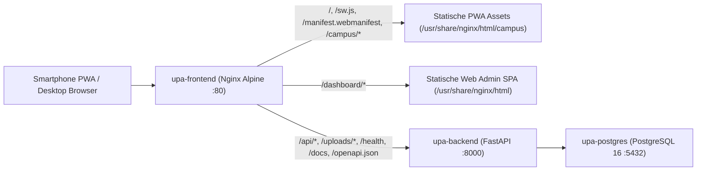

# UPA App: Systemarchitektur und REST API Dokumentation

Technische Referenz der Container Architektur, des Nginx Routings sowie saemtlicher REST API Endpunkte fuer die UPA Campus PWA (`web-app/`) und das Web Admin Cockpit (`web-admin/`). Alle Endpunkte sind produktiv mit PostgreSQL 16 verknuepft und nach dem Zero Mock Standard verifiziert.

## 1. Container und Routing Architektur

Die Plattform basiert auf einer 3 Schichten Architektur in Docker Compose (`docker-compose.yml` fuer Produktion auf Port 8085 und `docker-compose.beta.yml` fuer Beta auf Port 8185):



### 1.1 Nginx Frontend Container (`web-admin/Dockerfile`, `web-admin/nginx.conf`)

Der Nginx Container liefert alle statischen Oberflaechen direkt aus und leitet dynamische API Aufrufe als Reverse Proxy an `http://backend:8000` weiter:

* **Root Pfad `/` (`web-app/index.html`):**
  * **Desktop Landingpage:** Erkennt Desktop Browser automatisch und praesentiert ein Smartphone Vorschaumodell (`phone-mockup`), einen dynamisch zur aktuellen Host URL berechneten SVG QR Code (`#qr-box`), einen Direktlink fuer die Web Vorschau (`/?app=1`) mit Rueckkehrleiste (`Volver al código QR`) sowie im Footer den dezenten Administrationslink `Acceso Administrativo` (`/dashboard/`).
  * **Mobile PWA Ansicht:** Oeffnet auf Android und iOS Browsern sowie im installierten Standalone Modus sofort die mobile App Oberflaeche mit den drei Reitern `Inicio`, `Agenda` und `Perfil`.
* **PWA Infrastruktur Pfade:**
  * `GET /sw.js`: Liefert `web-app/sw.js` mit `Service-Worker-Allowed: "/"` und `Cache-Control: no-cache, must-revalidate` aus.
  * `GET /manifest.webmanifest`: Liefert `web-app/manifest.webmanifest` (`application/manifest+json`) fuer die Homescreen Installation.
  * `GET /.well-known/assetlinks.json`: Liefert die Digital Asset Links fuer Android Trusted Web Activity (TWA).
  * `GET /campus/*`: Liefert CSS, JS, QR Bibliothek und Icons mit 24 Stunden Public Cache (`max-age=86400`) aus.
* **Web Admin Cockpit (`/dashboard/*`):**
  * `GET /dashboard` leitet per `HTTP 302` auf `/dashboard/publicaciones` weiter.
  * Alle Subrouten unter `/dashboard/` (`/dashboard/publicaciones`, `/dashboard/grupos`, `/dashboard/roles`, `/dashboard/ia`, `/dashboard/apis`, `/dashboard/historial`) werden per SPA Fallback auf `web-admin/index.html` aufgeloest.
* **Reverse Proxy Weiterleitungen an FastAPI (`http://backend:8000`):**
  * `/api/` (REST Endpunkte mit `proxy_read_timeout 60s`), `/uploads/` (Medien), `/health`, `/docs` und `/openapi.json`.

### 1.2 Basis URLs

* **Produktion HTTPS (NetBird):** `https://upa.eu1.netbird.services`
* **Beta HTTPS (NetBird):** `https://upa-beta.eu1.netbird.services`
* **Lokales Frontend (Produktion / Beta):** `http://localhost:8085` bzw. `http://localhost:8185`
* **Lokales Backend (Produktion / Beta):** `http://localhost:8000` bzw. `http://localhost:8100`
* **Swagger UI und OpenAPI 3.1 Schema:** `/docs` und `/openapi.json`

## 2. Systemstatus und Diagnose

### `GET /health` und `GET /frontend-health`
Verifiziert den Betriebsstatus des FastAPI Backends (`/health`) bzw. des Nginx Containers (`/frontend-health`).

**Antwort `GET /health` (`200 OK`):**
```json
{
  "status": "healthy",
  "environment": "production",
  "service": "upa-app-backend"
}
```

### `GET /api/system/diagnostics`
Liefert Echtzeit Telemetrie ueber den PostgreSQL Connection Pool, die Datenbanklatenz, Beitragszaehler, den Google Directory Service Account, die Google Classroom Konfiguration sowie Instagram und FCM Status.
* **Authentifizierung:** `Authorization: Bearer <access_token>` (Berechtigung `apis` erforderlich).

## 3. Authentifizierung und Benutzerprofil

### `GET /api/auth/login-google`
Startet den Google OAuth 2.0 Web Redirect Flow (`hd=upa.edu.py`, `access_type=offline`, Classroom Readonly Scopes).
* **Query Parameter:**
  * `return_to` (optional): Bei `return_to=campus` setzt das Backend `state=campus` und leitet nach erfolgreichem Callback an die PWA unter `/#token=<jwt>` weiter. Ohne `return_to=campus` erfolgt die Weiterleitung an das Web Admin Cockpit unter `/dashboard/?token=<jwt>`.
  * `force_consent` (optional, Standard `false`): Erzwingt bei `true` die erneute Google Zustimmung (`prompt=consent select_account`).

### `GET /api/auth/google`
OAuth 2.0 Callback Endpunkt. Tauscht den Google `code` gegen `id_token`, `access_token` und `refresh_token`, synchronisiert die Google Workspace Gruppen des Nutzers, speichert die Classroom Tokens in PostgreSQL und leitet mit dem signierten JWT weiter.

### `POST /api/auth/google`
Authentifiziert einen Client direkt anhand eines Google `id_token` fuer Konten unter `@upa.edu.py`.

**Anfrage:**
```json
{
  "id_token": "eyJhbGciOiJSUzI1NiIs...",
  "classroom_token": "ya29.a0AfH6SM...",
  "classroom_refresh_token": "1//0gSampleRefreshToken..."
}
```

**Antwort (`200 OK`):**
```json
{
  "access_token": "eyJhbGciOiJIUzI1NiIsInR5cCI6IkpXVCJ9...",
  "token_type": "bearer",
  "user": {
    "id": 3,
    "email": "estudiante@upa.edu.py",
    "full_name": "Estudiante UPA",
    "role": "user",
    "groups": [],
    "google_groups": [],
    "has_classroom_token": true,
    "permissions": []
  }
}
```

### `GET /api/auth/me` und `GET /api/users/me`
Gibt das aktuelle Benutzerprofil inklusive effektiver Modulberechtigungen (`permissions`) zurueck. Regulaere Studierende erhalten aus Datenschutzgruenden stets `groups: []` und `google_groups: []`.
* **Header:** `Authorization: Bearer <access_token>`

### `POST /api/auth/classroom-token`
Aktualisiert das Google Classroom OAuth Token und optional das Refresh Token des angemeldeten Nutzers und leert den In Memory Cache.
* **Header:** `Authorization: Bearer <access_token>`

### `POST /api/users/device-token`
Speichert idempotent ein FCM Push Token (`platform`: `android`, `ios` oder `web`) in der Tabelle `device_tokens`.
* **Header:** `Authorization: Bearer <access_token>`

## 4. Mobile PWA Endpunkte (Feed, App State und Agenda)

### `GET /api/v1/feed`
Liefert den Campus Feed fuer den PWA Reiter `Inicio`:
* **Oeffentlicher Modus (ohne Token):** Gibt `urgent_banners: []` und in `posts` ausschliesslich oeffentliche Instagram Beitraege (`@upalemana`) fuer `ALL` zurueck.
* **Authentifizierter Modus (mit Bearer Token):** Gibt aktive Eilmeldungen (`urgent_banners` vom Typ `EMERGENCY_BANNER`) und alle fuer den Nutzer freigegebenen News, Events und Instagram Beitraege (`posts`) sortiert nach `is_pinned` und Datum zurueck. Jeder Eintrag enthaelt `is_registered` und `registered_count`.
* **Query Parameter:** `group`, `limit` (Standard `20`), `offset` (Standard `0`).

**Antwort (`200 OK`):**
```json
{
  "urgent_banners": [
    {
      "id": 1,
      "title": "Aviso meteorologico",
      "summary": "Suspension de actividades presenciales",
      "content": "Debido al temporal severo las clases pasan a modalidad virtual.",
      "post_type": "EMERGENCY_BANNER",
      "is_pinned": true,
      "target_groups": ["ALL"],
      "image_url": "",
      "media_url": "",
      "media_type": "",
      "permalink": "",
      "link_url": "",
      "link_label": "",
      "created_at": "2026-10-30T12:00:00Z",
      "published_at": "2026-10-30T12:00:00Z",
      "is_registered": false,
      "registered_count": 0
    }
  ],
  "posts": [
    {
      "id": 2,
      "title": "Foro de Ingenieria 2026",
      "summary": "Auditorio UPA",
      "content": "Encuentro anual de ingenieria e innovacion.",
      "post_type": "MANUAL",
      "is_news": true,
      "is_event": true,
      "is_pinned": true,
      "has_registration": true,
      "event_start": "2026-11-05T14:00:00Z",
      "event_end": "2026-11-05T16:00:00Z",
      "location": "Auditorio UPA",
      "target_groups": ["ALL", "TIE"],
      "image_url": "",
      "media_url": "",
      "media_type": "",
      "permalink": "",
      "created_at": "2026-10-30T14:00:00Z",
      "published_at": "2026-10-30T14:00:00Z",
      "is_registered": true,
      "registered_count": 12
    }
  ]
}
```

### `GET /api/v1/agenda`
Liefert die konsolidierte Terminstruktur fuer den PWA Reiter `Agenda`. Kombiniert Veranstaltungen (`events`), persönliche Google Classroom Abgabefristen (`deadlines`) und die chronologische Timeline (`items`) in der Zeitzone `America/Asuncion`.
* **Header (Optional):** `Authorization: Bearer <access_token>`
* **Query Parameter:** `group`, `upcoming_only` (Standard `true`), `limit` (Standard `50`).

### `GET /api/v1/app-state`
Liefert den gebuendelten Initialzustand (`authenticated`, `user`, `feed`, `upcoming_events`, `upcoming_deadlines`) in einem einzigen HTTP Aufruf.

## 5. Veranstaltungen, News und 1 Klick RSVP

### `GET /api/events` und `GET /api/events/{event_id}`
Listet Veranstaltungen chronologisch nach `event_start` bzw. ruft ein einzelnes Event inklusive View Tracking ab.
* **Header:** `Authorization: Bearer <access_token>`

### `POST /api/events/{event_id}/register` und `DELETE /api/events/{event_id}/register`
Meldet den authentifizierten Studierenden per 1 Klick fuer ein Event an (`POST`) oder storniert die Anmeldung (`DELETE`) und liefert das aktualisierte `EventResponse` (`is_registered`, `registered_count`) zurueck.
* **Header:** `Authorization: Bearer <access_token>`

### `GET /api/events/{event_id}/registrations`
Liefert fuer Redakteure und Administratoren die Teilnehmerliste samt E-Mail und Zeitstempel.

### `POST /api/events`, `PUT /api/events/{event_id}`, `DELETE /api/events/{event_id}`
Administrative CRUD Endpunkte fuer Kalenderveranstaltungen mit automatischer Audit Protokollierung.

### `GET /api/news`, `GET /api/news/{post_id}`, `POST /api/news`, `PUT /api/news/{post_id}`, `DELETE /api/news/{post_id}`
Endpunkte zum Abrufen und Verwalten von Campus Mitteilungen. Beim Erstellen einer `EMERGENCY_BANNER` Mitteilung wird automatisch der asynchrone FCM Push Versand fuer die adressierten Zielgruppen ausgeloest.

## 6. Vereinheitlichte Publikationen und Multimodale KI Integration (Google Gemini Flash)

### `GET`, `POST`, `PUT`, `DELETE /api/publications`
Zentraler Single Source of Truth Endpunkt des Web Admin Cockpits (`/dashboard/publicaciones`):
* Verwaltet Beitraege, die gleichzeitig Mitteilung (`is_news`), Veranstaltung (`is_event`) oder beides sein koennen.
* Erzwingt bei `is_pinned = true` ein Pflichtablaufdatum (`expires_at`).
* Schuetzt synchronisierte Instagram Felder (`caption`, `content`, `media_url`, `permalink`, `published_at`) im Bearbeitungsmodus vor versehentlichem Ueberschreiben.
* Kennzeichnet automatisch durch die KI als Veranstaltung erkannte Instagram Posts mit `is_ai_generated: true` (Badge `IA` im Cockpit).
* Unterstuetzt RSVP (`POST /api/publications/{publication_id}/rsvp`), Teilnehmerlisten (`GET /api/publications/{publication_id}/registrations`) und eindeutiges View Tracking (`POST /api/publications/{publication_id}/view`).

### `POST /api/publications/autocomplete-ai`
Multimodaler KI Endpunkt fuer den Button `Autocompletar con IA` im Publikations Editor:
* **Berechtigung:** `Authorization: Bearer <access_token>` (Berechtigung `publicaciones`).
* **Eingabe:** JSON Objekt oder `multipart/form-data` mit den aktuellen Formularwerten (`title`, `caption`, `content`, `location`, `event_start`, `event_end`, `target_groups`, `category`, `link_label`, `link_url`, `media_url`, `image_base64`) sowie optionaler Bilddatei (`file` / `image` im Format `JPG`, `PNG`, `WEBP` oder `PDF`).
* **Verhalten:** Sendet die vorhandenen Angaben und das Plakatbild an Google Gemini Flash (`gemini-2.0-flash` / `gemini-2.5-flash`) und gibt **ausschliesslich Vorschlaege fuer diejenigen Felder zurueck, die im Formular noch leer sind**. Bereits vom Nutzer eingetragene Werte bleiben garantiert unveraendert.

**Beispiel Antwort (`200 OK`):**
```json
{
  "location": "Aula Magna UPA",
  "event_start": "2026-11-10T18:00",
  "event_end": "2026-11-10T20:00",
  "target_groups": ["estudiantes", "TIE"],
  "category": "VERANSTALTUNG",
  "is_event": true,
  "has_registration": true
}
```

### `GET /api/ai/config`, `POST /api/ai/config`, `POST /api/ai/test-connection`
Endpunkte des Cockpits Reiters `Control de IA` (`/dashboard/ia`):
* **`GET /api/ai/config`:** Gibt `{"configured": true, "masked_key": "AIza********9xYz", "source": "database", "model": "gemini-2.0-flash"}` zurueck (Berechtigung `apis`).
* **`POST /api/ai/config`:** Speichert den Google AI Studio API Schluessel persistent in PostgreSQL (`app_settings`, nur `admin`).
* **`POST /api/ai/test-connection`:** Fuehrt einen Live Verbindungstest gegen Google Gemini aus und liefert `{ "ok": true, "code": "OK", "message": "Conexión exitosa con Google Gemini (Modelo gemini-2.0-flash listo)", "model": "gemini-2.0-flash" }` bzw. eine praezise Fehlermeldung (`NO_KEY`, `INVALID_KEY`, `QUOTA`, `TIMEOUT`, `NETWORK`).

### Multimodale Instagram Synchronisation (`POST /api/v1/feed/sync` und `POST /api/news/sync-instagram`)
Synchronisiert das offizielle Instagram Profil (`@upalemana`) ueber die Instagram Graph API oder SociableKIT:
* Bei jedem neu importierten Instagram Post analysiert `extract_event_from_instagram_post` (`backend/src/services/ai_extractor.py`) sowohl den Caption Text als auch das heruntergeladene Flyer Bild multimodal mit Google Gemini Flash.
* Erkennt die KI eine Veranstaltung (`is_event == true` mit gueltiger `start_time`), wird der Beitrag direkt ohne Entwurfszwischenschritt als aktives Event (`is_event = true`, `is_ai_generated = true`) mit Startzeit, Endzeit (strikte Plausibilitaetsregel: Start und Ende muessen am selben Kalendertag liegen), Ort und konservativ ausgewaehlten Zielgruppen veroeffentlicht.
* Ist die KI deaktiviert oder tritt ein Timeout/Quota Fehler auf, wird der Beitrag unterbrechungsfrei als regulärer Instagram News Post gespeichert.

## 7. Google Classroom Integration

### `GET /api/classroom/courses` und `GET /api/classroom/deadlines`
* **`GET /api/classroom/courses`:** Liefert die aktiven Kurse des Studierenden aus Google Classroom (`id`, `name`, `section`, `alternate_link`, `room`).
* **`GET /api/classroom/deadlines`:** Liefert die veroeffentlichten Aufgaben und Abgabefristen (`id`, `assignment_id`, `course_id`, `course`, `course_name`, `title`, `description`, `due_date`, `due_time`, `due_date_formatted`, `alternate_link`, `max_points`).
* **Resilienz und Persistenz:** Erneuert abgelaufene Classroom Tokens automatisch ueber `classroom_refresh_token`, rechnet UTC Abgabezeiten auf `America/Asuncion` um und faellt bei Google API Störungen auf die in `users.classroom_deadlines_cache` gespeicherten Fristen zurueck (`X-Classroom-Cache: db_fallback`).

## 8. Gruppen, Rollen, Audit Historie und Medien

* **`GET /api/groups`, `POST /api/groups`, `PUT /api/groups/{group_id}`, `DELETE /api/groups/{group_id}`:** Alphabetisch sortierte Verwaltung der Zielgruppen (`audience_groups`). E-Mail Listen werden nur ausgeliefert, wenn der Nutzer die Berechtigung `grupos` besitzt.
* **`GET /api/groups/google-workspace`:** Liefert die Gruppen der Google Workspace Domain `@upa.edu.py` mit lokalem Datenbank Fallback.
* **`GET /api/roles`, `POST /api/roles`, `PUT /api/roles/{email}`, `DELETE /api/roles/{email}`:** Verwaltung der Berechtigungsmatrix (`publicaciones`, `grupos`, `roles`, `apis`, `historial`). Stellt sicher, dass neue Konten standardmaessig ohne gesetzte Haekchen starten und mindestens ein Konto mit `roles` Berechtigung erhalten bleibt.
* **`GET /api/history/{entity_type}` und `GET /api/history/{entity_type}/{key}`:** Tabellarisches Audit Log fuer `post`, `group` und `role` inklusive Feld Diffs (`+publicaciones, -historial`), geschuetzt durch die Berechtigung `historial`.
* **`POST /api/media/upload` und `GET /uploads/{filename}`:** Persistenter Upload von Bildern (`JPG`, `PNG`, `WEBP`), Videos (`MP4`, `WEBM`) und `PDF` bis 10 MB mit Magic Byte Validierung und unveränderlichem Langzeit Caching.
